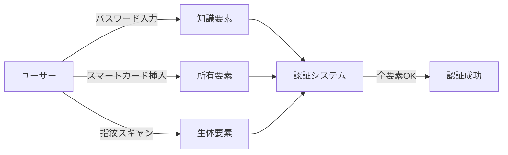
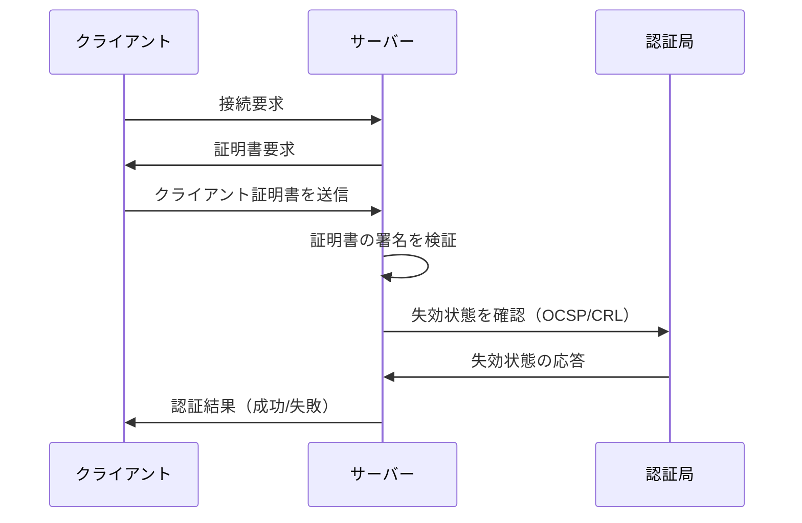
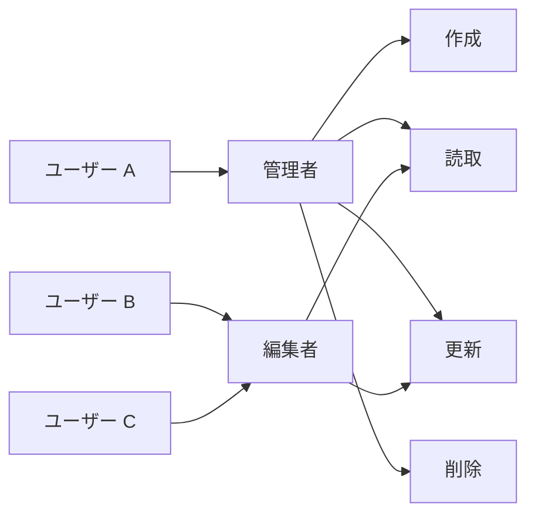
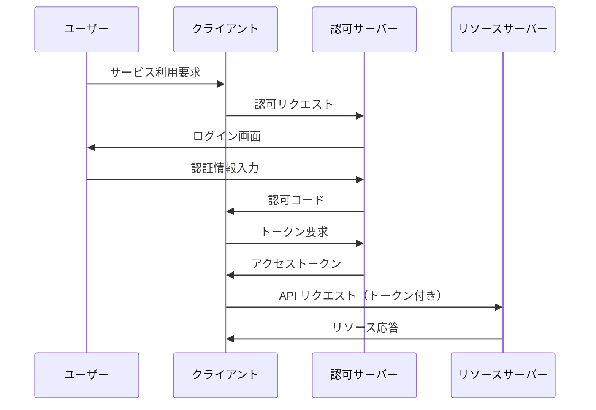

# 認証（Authentication）と認可（Authorization）

認証と認可は、セキュリティシステムにおける基本的な概念であり、しばしば混同されるが、異なる目的を持つ。本ドキュメントでは、これらの概念の違いと、PKI における役割について説明する。

## 認証と認可の違い

認証と認可は、セキュリティの異なる側面を担当する。以下にその違いを示す。

| 項目       | 認証（Authentication）   | 認可（Authorization）      |
| ---------- | ------------------------ | -------------------------- |
| 目的       | 「誰であるか」を確認する | 「何ができるか」を決定する |
| 質問       | "Who are you?"           | "What can you do?"         |
| タイミング | 認可の前に実行される     | 認証の後に実行される       |
| 失敗時     | 401 Unauthorized         | 403 Forbidden              |
| 例         | ログイン、証明書検証     | アクセス制御、権限チェック |

## 認証の方式

認証には複数の方式があり、セキュリティ要件に応じて適切な方式を選択する。

### 認証要素の分類

認証要素は、以下の3つのカテゴリに分類される。

| 認証要素                   | 説明                     | 例                               |
| -------------------------- | ------------------------ | -------------------------------- |
| 知識（Something you know） | 本人だけが知っている情報 | パスワード、PIN、秘密の質問      |
| 所有（Something you have） | 本人だけが持っている物   | スマートカード、トークン、私有鍵 |
| 生体（Something you are）  | 本人の身体的特徴         | 指紋、虹彩、顔認証               |

### 多要素認証（MFA）

複数の認証要素を組み合わせることで、セキュリティを強化する。

## PKI における認証

PKI では、デジタル証明書を使用した認証が行われる。これは「所有」要素に基づく認証の一種である。

### 証明書ベースの認証プロセス

証明書ベースの認証では、以下のステップで本人確認が行われる。

### 証明書検証の要件

RFC 5280 では、証明書の検証において以下の要件が定められている。

| 要件レベル | 項目         | 説明                                         |
| ---------- | ------------ | -------------------------------------------- |
| MUST       | 署名検証     | 証明書の署名が有効でなければならない         |
| MUST       | 有効期間     | 証明書が有効期間内でなければならない         |
| MUST       | 発行者検証   | 証明書の発行者が信頼できなければならない     |
| SHOULD     | 失効確認     | 証明書が失効していないことを確認すべきである |
| MAY        | ポリシー検証 | 証明書ポリシーを検証してもよい               |

## 認可のモデル

認可には複数のモデルがあり、システムの要件に応じて選択する。

### 主要な認可モデル

| モデル                         | 説明                                     | 用途               |
| ------------------------------ | ---------------------------------------- | ------------------ |
| DAC（任意アクセス制御）        | リソース所有者がアクセス権を設定         | ファイルシステム   |
| MAC（強制アクセス制御）        | システムがセキュリティラベルに基づき制御 | 軍事・政府システム |
| RBAC（役割ベースアクセス制御） | ユーザーの役割に基づきアクセス権を付与   | 企業システム       |
| ABAC（属性ベースアクセス制御） | 複数の属性に基づきアクセスを決定         | クラウドサービス   |

### RBAC の構造

役割ベースアクセス制御（RBAC）では、ユーザーは役割を通じて権限を取得する。

## X.509 証明書における認可情報

X.509 証明書には、認可に関連する拡張フィールドが含まれることがある。

| 拡張フィールド       | 説明                                                     |
| -------------------- | -------------------------------------------------------- |
| Key Usage            | 鍵の使用目的（署名、暗号化等）を制限                     |
| Extended Key Usage   | より詳細な用途（サーバー認証、クライアント認証等）を指定 |
| Certificate Policies | 証明書のポリシーと用途を示す                             |
| Name Constraints     | 発行可能な証明書の名前空間を制限                         |

## OAuth 2.0 と OpenID Connect

Web サービスにおける認証と認可の標準プロトコルとして、OAuth 2.0 と OpenID Connect がある。

| プロトコル     | 目的                                         | RFC                                                                          |
| -------------- | -------------------------------------------- | ---------------------------------------------------------------------------- |
| OAuth 2.0      | 認可（リソースへのアクセス権限の委譲）       | [RFC 6749](https://datatracker.ietf.org/doc/html/rfc6749)                    |
| OpenID Connect | 認証（OAuth 2.0 上に構築された認証レイヤー） | [OpenID Connect Core](https://openid.net/specs/openid-connect-core-1_0.html) |

## 関連 RFC・規格

認証と認可に関連する主要な RFC と規格を以下に示す。

| 規格                                                        | タイトル                              | 説明                 |
| ----------------------------------------------------------- | ------------------------------------- | -------------------- |
| [RFC 5280](https://datatracker.ietf.org/doc/html/rfc5280)   | X.509 PKI Certificate and CRL Profile | 証明書ベースの認証   |
| [RFC 6749](https://datatracker.ietf.org/doc/html/rfc6749)   | OAuth 2.0 Authorization Framework     | 認可フレームワーク   |
| [RFC 7519](https://datatracker.ietf.org/doc/html/rfc7519)   | JSON Web Token (JWT)                  | トークンベースの認証 |
| [RFC 7617](https://datatracker.ietf.org/doc/html/rfc7617)   | HTTP Basic Authentication             | 基本認証             |
| [RFC 6960](https://datatracker.ietf.org/doc/html/rfc6960)   | OCSP                                  | 証明書状態の確認     |
| [SAML 2.0](https://docs.oasis-open.org/security/saml/v2.0/) | Security Assertion Markup Language    | 企業向け SSO         |

## 日本における法令との関係

認証と認可は、以下の日本の法令・制度で規定されている。

| 法令・制度                                                                 | 説明                             |
| -------------------------------------------------------------------------- | -------------------------------- |
| [電子署名法](https://elaws.e-gov.go.jp/document?lawid=412AC0000000102)     | 電子署名による本人認証の法的効力 |
| [個人情報保護法](https://elaws.e-gov.go.jp/document?lawid=415AC0000000057) | 個人情報へのアクセス制御要件     |
| [マイナンバー法](https://elaws.e-gov.go.jp/document?lawid=425AC0000000027) | 特定個人情報の取扱い要件         |
| [JPKI](https://www.jpki.go.jp/)                                            | 公的個人認証サービス             |

電子署名法では、認定認証業務によって発行された電子証明書を使用した電子署名は、本人による署名と推定される効力を持つ
