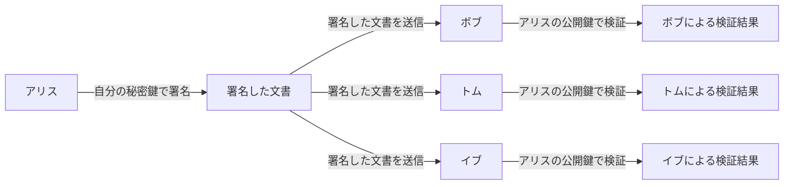
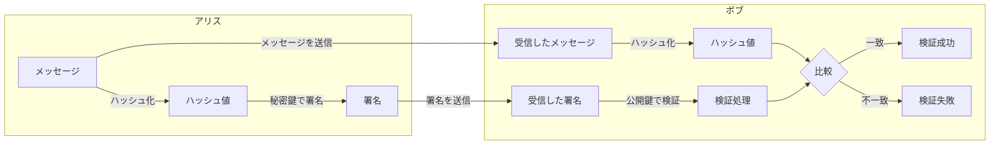
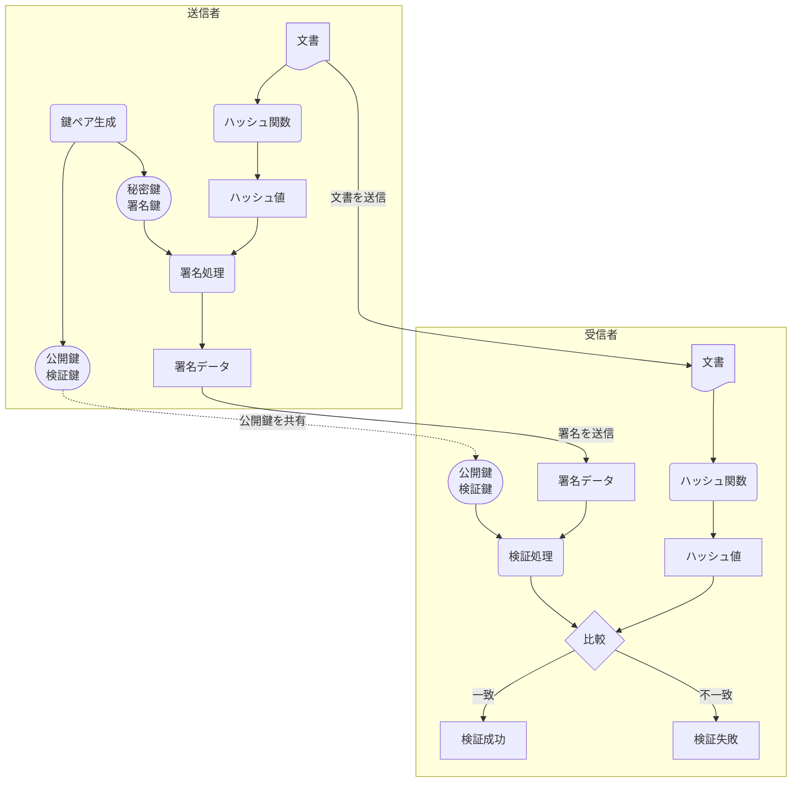
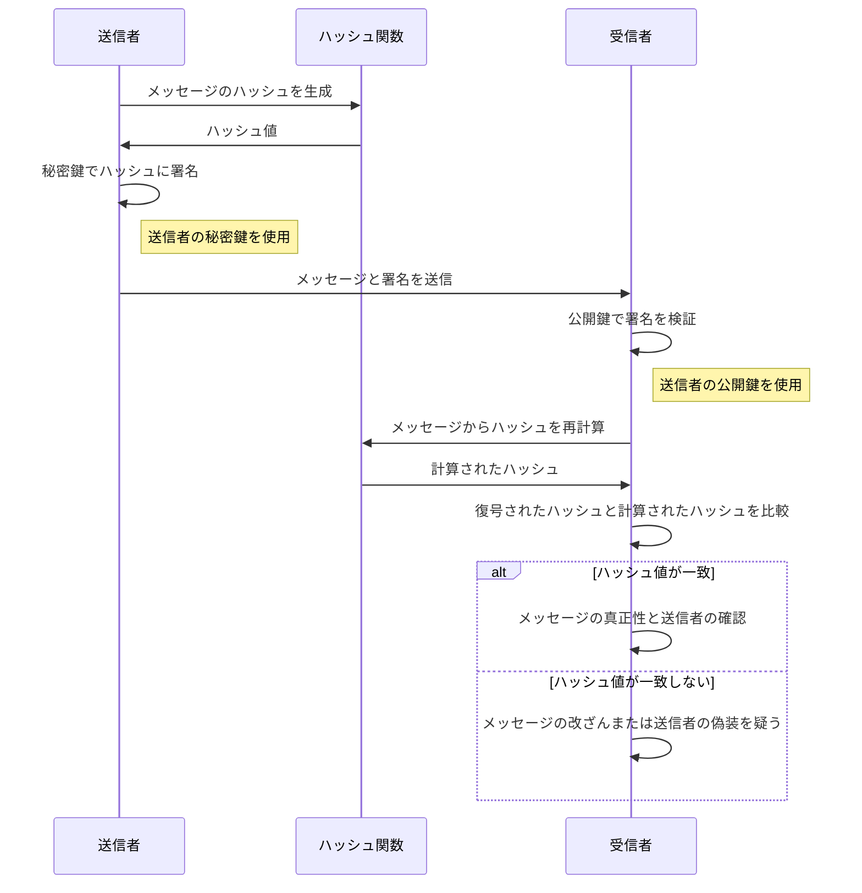

# デジタル署名 (Digital Signature)

デジタル署名は、文書やメッセージが改ざんされていないことを確認し、送信者が本人であることを証明するために使用される。
また、デジタル署名をすることで、このメッセージを書いたのは誰かを保証する。

> 参照: [RFC 5652](https://datatracker.ietf.org/doc/html/rfc5652) - Cryptographic Message Syntax (CMS)

## デジタル署名の目的

デジタル署名は、電子データや文書の信頼性と完全性を確保するための技術である。
**メッセージの真正性と送信者の身元を証明すること**を目的としている。

| 保証                       | 説明                                 | RFC 参照             |
| -------------------------- | ------------------------------------ | -------------------- |
| 認証 (Authentication)      | 送信者が本人であることを確認         | RFC 5652 Section 5   |
| 完全性 (Integrity)         | データや文書が変更されていないこと   | RFC 5652 Section 5.6 |
| 否認防止 (Non-repudiation) | 送信者がメッセージを否認できないこと | RFC 5652 Section 5.3 |

## デジタル署名が保証するもの

デジタル署名を行うことで、以下のようにその文書やデータを「誰が」作ったのかと、「何を」つまりデジタル署名を行った文書やデータを保証する。

### 「誰が」を保証する

デジタル署名を行った署名する個人または組織（送信者）であること間違いないことを証明する。

### 「何を」を保証する

デジタル署名を施した、対象の文書及びデータが改竄されていないことを証明する。

## デジタル署名における鍵の役割

デジタル署名の利用では、公開鍵暗号の暗号化の手法とは逆に、自分の秘密鍵でメッセージダイジェスト（ハッシュ値）を暗号化することで、公開鍵を持っている誰もが解読することが可能にする。

デジタル署名では公開鍵暗号方式の鍵ペアを使用する。それぞれの鍵の役割と用途を以下に示す。

| 鍵の種類 | 利用者           | 役割     | 用途                                              |
| -------- | ---------------- | -------- | ------------------------------------------------- |
| 秘密鍵   | 署名者本人       | 署名生成 | ダイジェストまたは signedAttrs に対して署名を生成 |
| 公開鍵   | 検証者（誰でも） | 署名検証 | 署名値を検証し、ダイジェストの一致を確認          |

### 署名と検証フローでの鍵の扱い

デジタル署名の利用では、自分の秘密鍵を使用してメッセージのハッシュ（要約）を暗号化し、公開鍵を持っている誰もが解読することが可能である。ただし暗号化は秘密鍵を持っている本人しかできない。



> **ポイント:**
>
> - 署名を行えるのは、秘密鍵を持っている送信者のみ
> - 署名を検証できるのは、送信者の公開鍵を持っている誰でも

## デジタル署名で解決できない問題

- 利用する公開鍵が本物であるか
- 公開鍵のなりすまし
- 公開鍵の第三者による証明が必要

この問題を解決する手段として、[公開鍵認証基盤 (PKI)](PublicKeyCryptographyInfrastructure.md) の利用が一般的である。

## RFC 5652 - Cryptographic Message Syntax (CMS)

RFC 5652 は、デジタル署名、ダイジェスト、認証、暗号化のための構文を定義する標準である。
CMS は PKCS #7 から派生し、現在の電子署名の基盤となっている。

### CMS の主要コンテンツタイプ

CMS では複数のコンテンツタイプが定義されている。デジタル署名には signed-data タイプを使用する。

| タイプ             | OID                       | 説明                   | 実装要件 |
| ------------------ | ------------------------- | ---------------------- | -------- |
| data               | 1.2.840.113549.1.7.1      | 任意のオクテット列     | MUST     |
| signed-data        | 1.2.840.113549.1.7.2      | 署名付きデータ         | MUST     |
| enveloped-data     | 1.2.840.113549.1.7.3      | 暗号化データ           | MUST     |
| digested-data      | 1.2.840.113549.1.7.5      | ダイジェスト付きデータ | MAY      |
| encrypted-data     | 1.2.840.113549.1.7.6      | 暗号化データ（鍵なし） | MAY      |
| authenticated-data | 1.2.840.113549.1.9.16.1.2 | 認証付きデータ         | MAY      |

> 参照: [RFC 5652 Section 2](https://datatracker.ietf.org/doc/html/rfc5652#section-2)

## SignedData 構造 (RFC 5652 Section 5.1)

デジタル署名の主要構造である SignedData の ASN.1 定義

```asn1
SignedData ::= SEQUENCE {
    version          CMSVersion,
    digestAlgorithms DigestAlgorithmIdentifiers,
    encapContentInfo EncapsulatedContentInfo,
    certificates     [0] IMPLICIT CertificateSet OPTIONAL,
    crls             [1] IMPLICIT RevocationInfoChoices OPTIONAL,
    signerInfos      SignerInfos
}

DigestAlgorithmIdentifiers ::= SET OF DigestAlgorithmIdentifier
SignerInfos ::= SET OF SignerInfo

id-signedData OBJECT IDENTIFIER ::= {
    iso(1) member-body(2) us(840) rsadsi(113549) pkcs(1) pkcs7(7) 2
}
```

### SignedData フィールド要件

SignedData 構造の各フィールドの役割と要件を以下に示す。signerInfos に実際の署名情報が格納される。

| フィールド       | 説明                                   | 要件                             |
| ---------------- | -------------------------------------- | -------------------------------- |
| version          | 構文バージョン番号                     | MUST（条件によりバージョン決定） |
| digestAlgorithms | 使用するダイジェストアルゴリズムの集合 | MAY（0個以上）                   |
| encapContentInfo | 署名対象のコンテンツ                   | MUST                             |
| certificates     | 証明書の集合                           | OPTIONAL                         |
| crls             | 失効情報の集合                         | OPTIONAL                         |
| signerInfos      | 署名者情報の集合                       | MAY（0個以上）                   |

> 参照: [RFC 5652 Section 5.1](https://datatracker.ietf.org/doc/html/rfc5652#section-5.1)

## SignerInfo 構造 (RFC 5652 Section 5.3)

署名者ごとの情報を格納する SignerInfo の ASN.1 定義

```asn1
SignerInfo ::= SEQUENCE {
    version            CMSVersion,
    sid                SignerIdentifier,
    digestAlgorithm    DigestAlgorithmIdentifier,
    signedAttrs        [0] IMPLICIT SignedAttributes OPTIONAL,
    signatureAlgorithm SignatureAlgorithmIdentifier,
    signature          SignatureValue,
    unsignedAttrs      [1] IMPLICIT UnsignedAttributes OPTIONAL
}

SignerIdentifier ::= CHOICE {
    issuerAndSerialNumber IssuerAndSerialNumber,
    subjectKeyIdentifier  [0] SubjectKeyIdentifier
}

SignedAttributes   ::= SET SIZE (1..MAX) OF Attribute
UnsignedAttributes ::= SET SIZE (1..MAX) OF Attribute
SignatureValue     ::= OCTET STRING
```

### SignerInfo フィールド要件

署名者ごとの情報を格納する SignerInfo の各フィールド要件を以下に示す。

| フィールド         | 説明                                                              | 要件                                       |
| ------------------ | ----------------------------------------------------------------- | ------------------------------------------ |
| version            | issuerAndSerialNumber の場合は 1、subjectKeyIdentifier の場合は 3 | MUST                                       |
| sid                | 署名者の証明書を識別                                              | MUST                                       |
| digestAlgorithm    | ダイジェストアルゴリズム                                          | SHOULD（digestAlgorithms に含まれるもの）  |
| signedAttrs        | 署名対象の属性                                                    | MUST（eContentType が id-data 以外の場合） |
| signatureAlgorithm | 署名アルゴリズム                                                  | MUST                                       |
| signature          | 署名値                                                            | MUST                                       |
| unsignedAttrs      | 署名対象外の属性                                                  | OPTIONAL                                   |

### signedAttrs の必須属性

signedAttrs が存在する場合、以下の属性を含まなければならない（MUST）

| 属性           | OID                  | 説明                               |
| -------------- | -------------------- | ---------------------------------- |
| content-type   | 1.2.840.113549.1.9.3 | 署名対象コンテンツのタイプ         |
| message-digest | 1.2.840.113549.1.9.4 | コンテンツのメッセージダイジェスト |

> 参照: [RFC 5652 Section 5.3](https://datatracker.ietf.org/doc/html/rfc5652#section-5.3)

## デジタル署名と検証プロセス

デジタル署名は、公開鍵暗号学の技術を使用している。

- 送信者が秘密鍵で文書を署名
- 受信者は送信者の公開鍵を使用して署名を検証

このプロセスにより、文書の改ざんや送信者のなりすましを防ぐことができる。

### フロー図

次の例ではアリスが署名をし、ボブがその署名を検証する。署名プロセスでは、送信者が秘密鍵を使用して署名を生成し、受信者は送信者の公開鍵を使用してその署名を検証する。



以下の図は、署名の生成と検証における各要素の関係をより詳細に示している。送信者は鍵ペアを生成し、秘密鍵（署名鍵）で署名を行い、公開鍵（検証鍵）を受信者に共有する。



> [!CAUTION]
> 秘密鍵で暗号化しているのはRSAを使った署名アルゴリズムだけで説明できる仕組みで、世の中にはRSA以外の仕組みを使った署名
> アルゴリズムもたくさんあり、そこでは署名に暗号化や符号するアルゴリズムは存在しません。
> そのため、署名では秘密鍵で暗号化するとか、公開鍵で復号するといったことは誤りとなります
>
> - RSA署名では、秘密鍵でデータを「署名」（数学的には暗号化に似た処理）し、公開鍵でその署名を「検証」（復号に似た処理）する仕組みが直感的に理解しやすい。
> - しかし、他の署名アルゴリズム（例：ECDSA、EdDSAなど）では、署名の生成や検証が「暗号化」や「復号」というプロセスとは異なる数学的計算に基づいており、これらの用語を使うのは誤りである。

### シーケンス図



## 署名生成プロセス (RFC 5652 Section 5.4, 5.5)

### メッセージダイジェスト計算

1. 入力: encapContentInfo の eContent（OCTET STRING の値部分のみ、タグ・長さは含まない）
2. signedAttrs が存在する場合:
   - コンテンツのダイジェストを計算
   - signedAttrs の DER エンコード全体に対してダイジェストを計算
   - IMPLICIT [0] タグではなく、EXPLICIT SET OF タグを使用（MUST）

### 署名生成

| 入力                   | 説明                         |
| ---------------------- | ---------------------------- |
| メッセージダイジェスト | 上記計算結果                 |
| 署名者の秘密鍵         | 署名アルゴリズムに対応する鍵 |

署名値は OCTET STRING としてエンコードし、signature フィールドに格納する（MUST）。

> 参照: [RFC 5652 Section 5.5](https://datatracker.ietf.org/doc/html/rfc5652#section-5.5)

## 署名検証プロセス (RFC 5652 Section 5.6)

### 検証要件

| 要件                   | レベル   | 説明                                                       |
| ---------------------- | -------- | ---------------------------------------------------------- |
| 独自のダイジェスト計算 | MUST NOT | 送信者が計算したダイジェスト値に依存してはならない         |
| ダイジェスト再計算     | MUST     | signedAttrs が存在する場合、Section 5.4 に従って計算       |
| ダイジェスト値の一致   | MUST     | 計算値と messageDigest 属性値が一致すること                |
| content-type の一致    | MUST     | signedAttrs の content-type と eContentType が一致すること |

### 検証手順

1. 署名者の公開鍵を取得（certificates フィールドから取得することを推奨）
2. メッセージダイジェストを独自に計算
3. 計算したダイジェストと messageDigest 属性の値を比較
4. signedAttrs が存在する場合、content-type 属性と eContentType の一致を確認
5. 署名値を署名者の公開鍵で検証

> 参照: [RFC 5652 Section 5.6](https://datatracker.ietf.org/doc/html/rfc5652#section-5.6)

## 有用な属性 (RFC 5652 Section 11)

### 署名属性 (signedAttrs)

| 属性           | OID                  | 要件     | 説明                       |
| -------------- | -------------------- | -------- | -------------------------- |
| content-type   | 1.2.840.113549.1.9.3 | MUST     | 署名対象のコンテンツタイプ |
| message-digest | 1.2.840.113549.1.9.4 | MUST     | コンテンツのダイジェスト値 |
| signing-time   | 1.2.840.113549.1.9.5 | OPTIONAL | 署名時刻                   |

### 非署名属性 (unsignedAttrs)

| 属性             | OID                  | 説明   |
| ---------------- | -------------------- | ------ |
| countersignature | 1.2.840.113549.1.9.6 | 副署名 |

### signing-time の形式

| 年        | 形式            | 要件 |
| --------- | --------------- | ---- |
| 1950-2049 | UTCTime         | MUST |
| 2050 以降 | GeneralizedTime | MUST |

> 参照: [RFC 5652 Section 11](https://datatracker.ietf.org/doc/html/rfc5652#section-11)

## 実装例 (OpenSSL)

### 署名生成

```bash
# 秘密鍵でメッセージに署名
openssl dgst -sha256 -sign private_key.pem -out signature.bin message.txt
```

### 署名検証

```bash
# 公開鍵で署名を検証
openssl dgst -sha256 -verify public_key.pem -signature signature.bin message.txt
```

### CMS 署名（SignedData）

```bash
# CMS SignedData 形式で署名
openssl cms -sign -in message.txt -signer cert.pem -inkey private_key.pem \
    -outform DER -out signed.p7s

# CMS SignedData の検証
openssl cms -verify -in signed.p7s -inform DER -CAfile ca.pem -out verified.txt
```

## デジタル署名の用途

| 用途               | 説明                                                         |
| ------------------ | ------------------------------------------------------------ |
| データの完全性保証 | データが送信後に改ざんされていないことを保証                 |
| 送信者の認証       | 公開鍵で署名を検証し、送信者の身元を確認                     |
| 否認防止           | 秘密鍵で署名した行為を後で否認できない                       |
| ソフトウェア配布   | 正規のソフトウェアであることを保証し、マルウェアリスクを軽減 |

## デジタル署名を証跡とすると有効な行為

| 行為               | 説明                                                           |
| ------------------ | -------------------------------------------------------------- |
| 契約の締結         | 契約の合法性と有効性を保証し、当事者が内容に同意したことを確認 |
| 法的誓約の履行     | 履行者が内容に確実に同意したことを証明し、後からの否認を防止   |
| 同意の確認         | プライバシーポリシーへの同意等、同意が確実に行われたことを保証 |
| 法的文書の発行     | 裁判所の決定や法的通知等の真正性と信頼性を維持                 |
| 知的財産の保護     | 著作権や特許申請の提出内容の確実性を保証                       |
| 医療情報の管理     | 電子医療記録の完全性を維持し、患者のプライバシーを保護         |
| 政府への申請の提出 | 税金申告やビザ申請等、提出者の身元と申告内容の正確性を保証     |
| 教育証明の認証     | 成績証明書や卒業証書の真正性と発行元の確認が可能               |

## 有効期限と長期検証

### タイムスタンプによる有効期限延長

証明書の有効期限が切れても、署名時に有効であった場合（タイムスタンプで証明）は検証可能。

### PAdES 形式

PAdES では、署名に関連するすべての検証データ（証明書、失効情報、タイムスタンプ）を文書に含めることで、長期間にわたる署名検証が可能。

> 参照: [長期署名 (LongTermSignature)](LongTermSignature.md)

## 関連 RFC

| RFC                                                       | タイトル                              | 説明                   |
| --------------------------------------------------------- | ------------------------------------- | ---------------------- |
| [RFC 5652](https://datatracker.ietf.org/doc/html/rfc5652) | Cryptographic Message Syntax (CMS)    | 本文書の主要参照       |
| [RFC 8017](https://datatracker.ietf.org/doc/html/rfc8017) | PKCS #1: RSA Cryptography             | RSA 署名アルゴリズム   |
| [RFC 5280](https://datatracker.ietf.org/doc/html/rfc5280) | X.509 PKI Certificate and CRL Profile | 証明書プロファイル     |
| [RFC 3161](https://datatracker.ietf.org/doc/html/rfc3161) | Time-Stamp Protocol (TSP)             | タイムスタンプ         |
| [RFC 2119](https://datatracker.ietf.org/doc/html/rfc2119) | Key words for RFCs                    | MUST/SHOULD/MAY の定義 |

## 関連法令

### 電子署名法（平成十二年法律第百二号）

電子署名及び認証業務に関する法律において、電子署名の定義と法的効力が規定されている。

> 詳細: [e-Gov 法令検索 - 電子署名法](https://laws.e-gov.go.jp/law/412AC0000000102)
