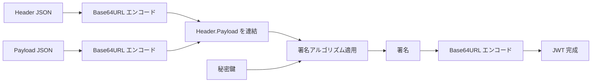
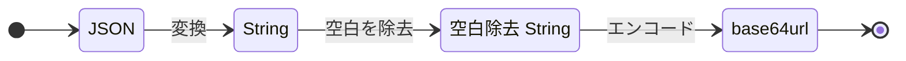
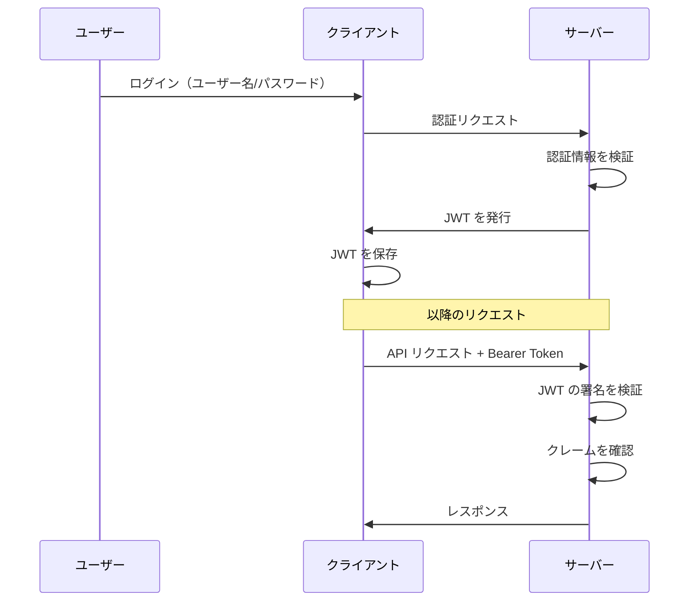

# JWT (JSON Web Token)

JWT（JSON Web Token）は、Web アプリケーション間で情報を安全に伝送するためのコンパクトで URL セーフな手段である。このトークンは、主に認証や情報交換に使用される。

> 参照: [RFC 7519](https://datatracker.ietf.org/doc/html/rfc7519) - JSON Web Token (JWT)

## 概要

JWT は、JSON オブジェクトとしてクレーム（主張）をエンコードし、オプションで署名や暗号化を適用することで、情報の完全性と機密性を保護する。

### JWT の主な用途

JWT は以下のような用途で広く使用されている。特に Web アプリケーションにおけるステートレスな認証で重要な役割を果たす。

| 用途     | 説明                                                                    |
| -------- | ----------------------------------------------------------------------- |
| 認証     | ユーザーがログイン後、各リクエストに JWT を含めることでセッションを管理 |
| 情報交換 | 当事者間で安全に情報を伝送（署名により改ざんを検出可能）                |
| 認可     | ユーザーの権限情報をトークンに含めてアクセス制御                        |

## 構成

JWT はヘッダー、ペイロード、そして署名の 3 つの部分から構成されている。

| 要素      | 説明                                                                             | RFC 参照           |
| --------- | -------------------------------------------------------------------------------- | ------------------ |
| Header    | トークンのタイプ（JWT）と使用される署名アルゴリズムを宣言する JSON オブジェクト  | RFC 7519 Section 5 |
| Payload   | トークンに含まれるクレーム（主張）を表す JSON オブジェクト                       | RFC 7519 Section 4 |
| Signature | ヘッダーとペイロードを秘密鍵や公開鍵を用いて署名し、トークンの完全性と認証を保証 | RFC 7515           |

## フォーマット

JWT は `xxxxx.yyyyy.zzzzz` といった、ヘッダー、ペイロード、署名の 3 つの要素をピリオド（`.`）で区切って表現する。それぞれのピリオドで区切られた JSON オブジェクトは、Base64URL アルゴリズムを使ってエンコードされた文字列として表現される。

```
BASE64URL(Header).BASE64URL(Payload).BASE64URL(Signature)
```

> 参照: [RFC 7519 Section 3](https://datatracker.ietf.org/doc/html/rfc7519#section-3) - JSON Web Token (JWT) Overview

## ヘッダー (JOSE Header)

署名アルゴリズムとトークンのタイプを定義する。

```json
{
	"alg": "HS256",
	"typ": "JWT"
}
```

### 登録済みヘッダーパラメータ (RFC 7519 Section 5)

JOSE Header で使用できる登録済みパラメータを以下に示す。alg パラメータは必須であり、その他はオプションである。

| パラメータ | 説明                                              | 要件     |
| ---------- | ------------------------------------------------- | -------- |
| alg        | 署名または MAC に使用するアルゴリズム             | MUST     |
| typ        | トークンのタイプ（"JWT" を推奨）                  | OPTIONAL |
| cty        | コンテンツタイプ（ネストされた JWT の場合に使用） | OPTIONAL |

ヘッダーは通常、JWT であるトークンの種類と、HMAC SHA256 や RSA などの署名アルゴリズムの 2 つの部分で構成されている。トークンのタイプは他にも JWE (JSON Web Encryption) があり、これは暗号化まで仕様として定義している。

> 参照: [RFC 7519 Section 5](https://datatracker.ietf.org/doc/html/rfc7519#section-5) - JOSE Header

## ペイロード (JWT Claims Set)

トークンの 2 番目の部分は、クレームを含むペイロードである。

```json
{
	"sub": "1234567890",
	"name": "John Doe",
	"iat": 1516239022
}
```

### クレーム

クレームは、エンティティ（通常はユーザー）および追加データに関するステートメントである。クレームには、登録クレーム、パブリッククレーム、プライベートクレームの 3 種類がある。

> 参照: [IANA JSON Web Token Claims Registry](https://www.iana.org/assignments/jwt/jwt.xhtml)

## 予約クレーム (Registered Claim Names) - RFC 7519 Section 4.1

IANA の "JSON Web Token Claims" に登録された、一般的な用途で利用されることを想定されたクレームである。基本的にこれらのクレームの利用は任意であるが、JWT を発行する際には可能な限り含めておくことが推奨される。各クレームの意味と使用方法を以下に示す。

| クレーム | 説明                                                                                                                               | 要件     | RFC 参照      |
| -------- | ---------------------------------------------------------------------------------------------------------------------------------- | -------- | ------------- |
| iss      | JWT 発行者。アプリケーション名やドメイン名などの文字列や URL が一般的                                                              | OPTIONAL | Section 4.1.1 |
| sub      | JWT の主題。発行者から払い出されたユーザ識別子。同一発行者内でユニーク、または全世界でユニークであることが必要                     | OPTIONAL | Section 4.1.2 |
| aud      | JWT の想定利用者。文字列か URI、またはそれらの配列。発行する側は相手を識別する文字列か、自分向けに発行されたものかを検証用に用いる | OPTIONAL | Section 4.1.3 |
| exp      | JWT の有効期限（失効する日時）。NumericDate 値（UNIX 時刻）                                                                        | OPTIONAL | Section 4.1.4 |
| nbf      | JWT が有効になる日時。この時刻より前に JWT を処理してはならない（MUST NOT）                                                        | OPTIONAL | Section 4.1.5 |
| iat      | JWT を発行した時刻を示す NumericDate 値                                                                                            | OPTIONAL | Section 4.1.6 |
| jti      | JWT のユニーク性を担保する ID 値。同じ JWT を使い回すことを抑制するために使用。UUID を設定することが一般的                         | OPTIONAL | Section 4.1.7 |

### クレーム検証要件

JWT を受信した側は、以下の検証を行う必要がある。これらの検証を怠ると、期限切れのトークンや不正なトークンを受け入れてしまう可能性がある。

| 検証項目     | 要件   | 説明                                                                  |
| ------------ | ------ | --------------------------------------------------------------------- |
| exp クレーム | MUST   | 現在時刻が exp 値より後の場合、JWT を拒否しなければならない           |
| nbf クレーム | MUST   | 現在時刻が nbf 値より前の場合、JWT を拒否しなければならない           |
| iss クレーム | SHOULD | 発行者を検証する場合、期待する値と一致することを確認                  |
| aud クレーム | MUST   | 受信者は自身が aud に含まれていない場合、JWT を拒否しなければならない |

> 参照: [RFC 7519 Section 4.1](https://datatracker.ietf.org/doc/html/rfc7519#section-4.1)

## パブリッククレーム (Public Claim Names) - RFC 7519 Section 4.2

IANA "JSON Web Token Claims" に Public Claim のサブセットとして登録されているクレームである。主に汎用的な用途のクレームの衝突を（仕様的な意味で）排除する目的で利用される。代表的なパブリッククレームを以下に示す。

| クレーム       | 説明                         |
| -------------- | ---------------------------- |
| name           | フルネーム                   |
| email          | 優先メールアドレス           |
| auth_time      | 認証が発生した期間           |
| email_verified | メール確認済み               |
| at_hash        | アクセストークンのハッシュ値 |

> 参照: [IANA JSON Web Token Claims](https://www.iana.org/assignments/jwt/jwt.xhtml)

## プライベートクレーム (Private Claim Names) - RFC 7519 Section 4.3

このクレームは、JWT の Issuer と Audience の間で取り決めされた仕様に応じて何でも定義することができる。Private Claim は Registered Claim や Public Claim で予約された以外の名前を使うことができる。JWT をアクセストークンとして利用する場合は、大抵 Private Claim を利用することになる。

> 参照: [RFC 7519 Section 4.3](https://datatracker.ietf.org/doc/html/rfc7519#section-4.3)

## 署名

JWT の署名部分は、トークンの安全性を保証するための重要な要素である。署名は、トークンが改ざんされていないことを確認し、トークンが正当な発行者によって生成されたことを保証する。

署名は JWT の真正性と完全性を保証するために非常に重要である。署名がなければ、悪意のある第三者がトークンの内容を改ざんし、異なるユーザーとしてシステムにアクセスすることが可能になる。署名により、このような改ざんを検出し、セキュリティを保つことができる。

### JWT の署名プロセス



1. **ヘッダーとペイロードのエンコード**: ヘッダーとペイロードはそれぞれ JSON 形式から Base64URL 形式にエンコードされる。このエンコードはデータを URL や HTTP 環境で安全に送信できることを目的とする。

2. **データの結合**: エンコードされたヘッダーとペイロードをピリオド（`.`）で連結する。例: `encodedHeader.encodedPayload`

3. **署名の生成**: 連結した文字列に対して指定されたアルゴリズムを使用して署名を生成する。署名には通常、秘密鍵（または公開鍵/秘密鍵ペアの秘密鍵）が用いられる。

4. **JWT の完成**: 最終的に、署名も Base64URL エンコードされ、既にエンコードされたヘッダーとペイロードの後にピリオドで連結される。

### 署名アルゴリズム

JWT で使用される代表的な署名アルゴリズムを以下に示す。用途に応じて対称鍵（HMAC）と非対称鍵（RSA、ECDSA）を使い分ける。

| アルゴリズム | 種類     | 説明                                                                                         |
| ------------ | -------- | -------------------------------------------------------------------------------------------- |
| HS256        | 対称鍵   | HMAC with SHA-256。秘密鍵を使用して署名を生成し、同じ鍵を使用して署名を検証                  |
| RS256        | 非対称鍵 | RSA Signature with SHA-256。秘密鍵を使用して署名を生成し、対応する公開鍵を使用して署名を検証 |
| ES256        | 非対称鍵 | ECDSA with P-256 curve and SHA-256                                                           |
| none         | なし     | 署名なし（Unsecured JWT）。本番環境での使用は非推奨                                          |

> 参照: [RFC 7518](https://datatracker.ietf.org/doc/html/rfc7518) - JSON Web Algorithms (JWA)

## JWT の作成と検証 (RFC 7519 Section 7)

### JWT 作成手順

RFC 7519 で定義される JWT の作成手順を以下に示す。署名付き JWT（JWS）または暗号化された JWT（JWE）として生成する。

| ステップ | 説明                                                     | 要件 |
| -------- | -------------------------------------------------------- | ---- |
| 1        | 必要なクレームを含む JWT Claims Set を作成               | -    |
| 2        | Claims Set の UTF-8 表現をメッセージとする               | -    |
| 3        | 必要なヘッダーパラメータを含む JOSE Header を作成        | -    |
| 4        | JWS または JWE として署名または暗号化                    | MUST |
| 5        | ネストされた署名/暗号化を行う場合、"cty" に "JWT" を設定 | MUST |

### JWT 検証手順

受信した JWT を検証する際の手順を以下に示す。各ステップの検証に失敗した場合は、JWT を無効として拒否する必要がある。

| ステップ | 説明                                                            | 要件 |
| -------- | --------------------------------------------------------------- | ---- |
| 1        | JWT に少なくとも 1 つのピリオド（'.'）が含まれることを確認      | MUST |
| 2        | 最初のピリオドの前の部分を Encoded JOSE Header として抽出       | -    |
| 3        | Encoded JOSE Header を Base64URL デコード                       | MUST |
| 4        | 結果が UTF-8 エンコードされた JSON オブジェクトであることを確認 | MUST |
| 5        | JOSE Header に理解可能なパラメータのみが含まれることを確認      | MUST |
| 6        | JWT が JWS か JWE かを判断                                      | -    |
| 7        | JWS/JWE の検証を実行                                            | MUST |

> 参照: [RFC 7519 Section 7](https://datatracker.ietf.org/doc/html/rfc7519#section-7)

## エンコード/デコード

### Base64URL エンコード



### Base64 でエンコードする

```bash
echo -n '{"alg":"HS256","typ":"JWT"}' | base64
```

エンコード結果:

```
eyJhbGciOiJIUzI1NiIsInR5cCI6IkpXVCJ9
```

### Base64 でデコードする

```bash
echo -n 'eyJhbGciOiJIUzI1NiIsInR5cCI6IkpXVCJ9' | base64 -D
```

デコード結果:

```json
{ "alg": "HS256", "typ": "JWT" }
```

## 秘密鍵で署名生成

HMAC-SHA256 で署名を生成する例:

```bash
echo -n 'eyJhbGciOiJIUzI1NiIsInR5cCI6IkpXVCJ9.eyJzdWIiOiIxMjM0NTY3ODkwIiwibmFtZSI6IkpvaG4gRG9lIiwiaWF0IjoxNTE2MjM5MDIyfQ' | \
openssl dgst -binary -sha256 -hmac 'secret' | \
base64
```

## JWT の利用例（ユーザー認証）

JWT は、ログイン後のユーザーセッションを管理するために使用される。以下にユーザーが Web サイトにログインし、そのセッションで API リクエストを認証するために JWT を使用するケースを例としてあげる。

### ベアラー認証

通常は、ベアラー認証を通じて HTTP ヘッダーの Authorization にて JWT を送信する。

```
Authorization: Bearer <jwt token>
```

### ベアラー認証のフロー



1. **ユーザー認証**: ユーザーがユーザーネームとパスワードを使ってログインすると、サーバーはその認証情報を検証する。
2. **JWT の発行**: 認証が成功すると、サーバーはユーザーの識別情報やアクセス権限などのクレームを含む JWT を生成し、それをユーザーに返す。
3. **トークンの送信**: ユーザーはその後のリクエストで、JWT を HTTP リクエストの `Authorization` ヘッダーに `Bearer` スキームを使用して含める。
4. **トークンの検証**: サーバーはリクエストを受信するたびに、JWT の署名を検証し、有効期限などのクレームを確認して、リクエストが正当なものであるかを判断する。

## セキュリティ上の考慮事項 (RFC 7519 Section 11-12)

### 一般的なセキュリティ対策

JWT を安全に使用するために、以下のセキュリティ対策を実施することが重要である。

| 対策                   | 説明                                                                                                               |
| ---------------------- | ------------------------------------------------------------------------------------------------------------------ |
| HTTPS の使用           | JWT は `Authorization` ヘッダーを介して送信されるため、通信は HTTPS を通じて暗号化されるべき                       |
| トークンの保存         | クライアント側では、JWT を安全に保存する必要がある。XSS 攻撃に対するリスクがあるため、セキュリティ対策を適切に行う |
| 短い有効期限           | アクセストークンには短い有効期限を設定し、リフレッシュトークンで更新する                                           |
| 署名アルゴリズムの検証 | "alg": "none" を許可しない。予期しないアルゴリズムを拒否する                                                       |

### プライバシーの考慮事項

JWT のペイロードは署名されているが暗号化されていないため、プライバシーに関して以下の点に注意する必要がある。

| 項目               | 説明                                                                                                  |
| ------------------ | ----------------------------------------------------------------------------------------------------- |
| 機密情報           | JWT のペイロードは Base64URL エンコードされているだけで暗号化されていないため、機密情報を含めないこと |
| 暗号化が必要な場合 | JWE (JSON Web Encryption) を使用する                                                                  |

> 参照: [RFC 7519 Section 11-12](https://datatracker.ietf.org/doc/html/rfc7519#section-11)

## 実装要件 (RFC 7519 Section 8)

JWT を実装する際に必須またはの推奨されるアルゴリズムを以下に示す。相互運用性を確保するため、MUST のアルゴリズムは必ずサポートする必要がある。

| 要件        | アルゴリズム | 説明                            |
| ----------- | ------------ | ------------------------------- |
| MUST        | HS256        | HMAC using SHA-256              |
| RECOMMENDED | RS256        | RSASSA-PKCS1-v1_5 using SHA-256 |
| RECOMMENDED | ES256        | ECDSA using P-256 and SHA-256   |

> 参照: [RFC 7519 Section 8](https://datatracker.ietf.org/doc/html/rfc7519#section-8)

## 関連 RFC

JWT およびその関連技術に関する RFC 文書を以下に示す。

| RFC                                                       | タイトル                   | 説明                                 |
| --------------------------------------------------------- | -------------------------- | ------------------------------------ |
| [RFC 7519](https://datatracker.ietf.org/doc/html/rfc7519) | JSON Web Token (JWT)       | 本文書の主要参照                     |
| [RFC 7515](https://datatracker.ietf.org/doc/html/rfc7515) | JSON Web Signature (JWS)   | 署名仕様                             |
| [RFC 7516](https://datatracker.ietf.org/doc/html/rfc7516) | JSON Web Encryption (JWE)  | 暗号化仕様                           |
| [RFC 7517](https://datatracker.ietf.org/doc/html/rfc7517) | JSON Web Key (JWK)         | 鍵表現仕様                           |
| [RFC 7518](https://datatracker.ietf.org/doc/html/rfc7518) | JSON Web Algorithms (JWA)  | 暗号アルゴリズム仕様                 |
| [RFC 8725](https://datatracker.ietf.org/doc/html/rfc8725) | JWT Best Current Practices | JWT セキュリティのベストプラクティス |
| [RFC 2119](https://datatracker.ietf.org/doc/html/rfc2119) | Key words for RFCs         | MUST/SHOULD/MAY の定義               |

## 参考資料

- [jwt.io](https://jwt.io) - JWT のデバッグツール
- [IANA JSON Web Token Claims](https://www.iana.org/assignments/jwt/jwt.xhtml) - 登録済みクレーム一覧
