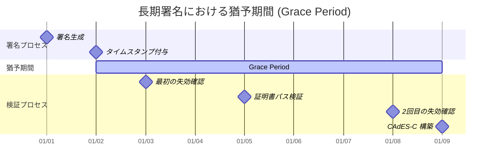
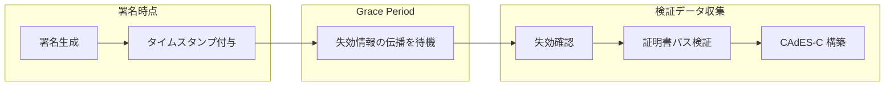

# 長期署名 (Long-Term Signature)

デジタル署名の有効期限が切れると電子証明書が失効状態となる。そのため、長期間にわたってデジタルデータの真正性を保証するための長期署名という形式がある。

特に企業や政府機関で必要とされる法的文書や契約書など、時間が経過してもその有効性を保持する必要がある文書に対して使用される。

> 参照: [RFC 5126](https://datatracker.ietf.org/doc/html/rfc5126) - CMS Advanced Electronic Signatures (CAdES)

## 概要

長期署名は以下の問題を解決する。

| 問題                     | 解決策                                 | RFC 参照               |
| ------------------------ | -------------------------------------- | ---------------------- |
| 証明書の有効期限切れ     | タイムスタンプで署名時点の有効性を証明 | RFC 5126 Section 4.4.1 |
| 失効情報の消失           | 検証データの埋め込み                   | RFC 5126 Section 4.4.2 |
| 暗号アルゴリズムの危殆化 | アーカイブタイムスタンプの追加         | RFC 5126 Section 4.4.4 |

## デジタル署名の有効期限

デジタル署名の有効期限は、署名に使用されるデジタル証明書の有効期限に依存する。一般的には、デジタル証明書の有効期限は 2〜3 年で、有効期限が切れると電子証明書が失効状態となる。

しかし、署名の有効性は証明書の有効期限後も確認できる場合がある。これは、署名が作成された時点での証明書の状態を保持し、それを基に署名の検証を行うためである。したがって、過去に署名された PDF ファイルのデジタル署名は、証明書の有効期限後も検証可能な場合がある。

### デジタル署名が有効期限以降は検証できなくなるのか？

過去に署名された PDF ファイルのデジタル署名について、その有効期限が過ぎた後も検証可能かどうかは、PDF がどのように署名されているかによる。

署名された PDF ファイルは、適切な検証データが含まれている場合、証明書の有効期限後も検証が行えることが多い。ただし、この機能をフルに利用するためには、署名時に適切な設定が施されている必要がある。

### タイムスタンプが施されていれば、署名自体が署名時に有効であった場合は検証は可能

一般的に、デジタル署名に使用される証明書の有効期限が切れても、署名自体が署名時に有効であった場合（証明書が有効で、適切な認証局によって発行されていた場合）、署名の検証は引き続き可能である。

この時、タイムスタンプ自体の有効期限が切れていても、署名された時点で有効であった記録（タイムスタンプが証明する証明書の有効性）が保持されていれば、文書の署名は依然として有効と見なされることが一般的である。

### PAdES 形式で署名すれば、署名に検証情報を付与するので検証が可能

PAdES では、署名に関連するすべての検証データ（証明書、失効情報、タイムスタンプなど）を文書に含めることができ、これにより長期間にわたって署名を検証することが可能である。

## 長期署名の役割

タイムスタンプとそれに関連する証明書の状況を定期的に評価し、必要に応じて新しいタイムスタンプを文書に適用することが推奨される。これにより、文書の信頼性を長期にわたって維持することが可能となる。

署名の長期的な検証を目的とした場合、特に PAdES-LTA（PDF Advanced Electronic Signatures - Long Term with Archiving）のような規格を採用することで、タイムスタンプの再適用などを通じて、文書の信頼性を確保するための手段が提供される。

## 長期署名の主要な要素

1. **デジタル署名**:
   - 文書またはデータに対して行われる通常のデジタル署名
   - 文書が署名された時点のデータの完全性と非改ざんが保証される

2. **タイムスタンプ**:
   - 署名された文書またはデータにタイムスタンプを追加
   - 署名がなされた正確な日時が記録され、証明書の有効期限が切れた後も文書の検証を可能にする

3. **証明書と失効情報**:
   - 署名に使用された証明書と、その証明書の失効リスト（CRL）または OCSP 応答が含まれる
   - 将来的にも証明書がその時点で有効だったことが証明できる

## CAdES (CMS Advanced Electronic Signatures)

RFC 5126 は CMS (Cryptographic Message Syntax) を拡張した電子署名形式を定義する。

### CAdES 形式の階層

```
CAdES-BES (Basic Electronic Signature)
    |
    v
CAdES-EPES (Explicit Policy-based Electronic Signature)
    |
    v
CAdES-T (Electronic Signature with Time)
    |
    v
CAdES-C (ES with Complete Validation Data References)
    |
    v
CAdES-X (Extended Electronic Signature)
    |
    v
CAdES-X Long (Extended Long Electronic Signature)
    |
    v
CAdES-A (Archival Electronic Signature)
```

> 参照: [RFC 5126 Section 4.3-4.4](https://datatracker.ietf.org/doc/html/rfc5126#section-4.3)

## CAdES-BES (Basic Electronic Signature)

CAdES-BES は CAdES の基本形式である。

### CAdES-BES の必須署名属性

CAdES-BES を構成するために必要な署名属性を以下に示す。これらの属性は署名の基本的な完全性を保証するために必須である。

| 属性                                              | OID                  | 説明                       | 要件 |
| ------------------------------------------------- | -------------------- | -------------------------- | ---- |
| content-type                                      | 1.2.840.113549.1.9.3 | 署名対象のコンテンツタイプ | MUST |
| message-digest                                    | 1.2.840.113549.1.9.4 | コンテンツのダイジェスト値 | MUST |
| signing-certificate または signing-certificate-v2 | -                    | 署名証明書への参照         | MUST |

### signing-certificate-v2 属性 (RFC 5035)

署名証明書を特定するための属性である。この属性により、署名に使用された証明書を一意に識別でき、証明書のすり替えを防止する。

```asn1
SigningCertificateV2 ::= SEQUENCE {
    certs        SEQUENCE OF ESSCertIDv2,
    policies     SEQUENCE OF PolicyInformation OPTIONAL
}

ESSCertIDv2 ::= SEQUENCE {
    hashAlgorithm  AlgorithmIdentifier DEFAULT {algorithm id-sha256},
    certHash       Hash,
    issuerSerial   IssuerSerial OPTIONAL
}
```

> 参照: [RFC 5126 Section 5.7.3](https://datatracker.ietf.org/doc/html/rfc5126#section-5.7.3)

## CAdES-T (Electronic Signature with Time)

CAdES-T は CAdES-BES または CAdES-EPES にタイムスタンプを追加した形式である。

### signature-time-stamp 属性

署名値に対してタイムスタンプを付与するための属性である。この属性により、署名が特定の時刻に存在していたことを証明できる。

```asn1
id-aa-signatureTimeStampToken OBJECT IDENTIFIER ::= {
    iso(1) member-body(2) us(840) rsadsi(113549) pkcs(1) pkcs-9(9)
    smime(16) aa(2) 14
}

SignatureTimeStampToken ::= TimeStampToken
```

### CAdES-T の要件

CAdES-T を構成するための要件を以下に示す。タイムスタンプは証明書が失効する前に取得することが推奨される。

| 要件                   | レベル | 説明                         |
| ---------------------- | ------ | ---------------------------- |
| タイムスタンプトークン | MUST   | 署名値に対するタイムスタンプ |
| タイムスタンプ生成時期 | SHOULD | 証明書失効前に生成           |

> 参照: [RFC 5126 Section 6.1.1](https://datatracker.ietf.org/doc/html/rfc5126#section-6.1.1)

## CAdES-C (ES with Complete Validation Data References)

CAdES-C は CAdES-T に証明書および失効情報への参照を追加した形式である。

### complete-certificate-references 属性

署名検証に必要な全ての証明書（署名者証明書を除く）への参照を格納する属性である。これにより、将来の検証時に必要な証明書チェーンを特定できる。

```asn1
id-aa-ets-certificateRefs OBJECT IDENTIFIER ::= {
    iso(1) member-body(2) us(840) rsadsi(113549) pkcs(1) pkcs-9(9)
    smime(16) aa(2) 21
}

CompleteCertificateRefs ::= SEQUENCE OF OtherCertID

OtherCertID ::= SEQUENCE {
    otherCertHash    OtherHash,
    issuerSerial     IssuerSerial OPTIONAL
}
```

### complete-revocation-references 属性

署名検証に必要な全ての失効情報（CRL や OCSP レスポンス）への参照を格納する属性である。これにより、署名時点での証明書の有効性を将来検証できる。

```asn1
id-aa-ets-revocationRefs OBJECT IDENTIFIER ::= {
    iso(1) member-body(2) us(840) rsadsi(113549) pkcs(1) pkcs-9(9)
    smime(16) aa(2) 22
}

CompleteRevocationRefs ::= SEQUENCE OF CrlOcspRef

CrlOcspRef ::= SEQUENCE {
    crlids     [0] CRLListID   OPTIONAL,
    ocspids    [1] OcspListID  OPTIONAL,
    otherRev   [2] OtherRevRefs OPTIONAL
}
```

> 参照: [RFC 5126 Section 6.2](https://datatracker.ietf.org/doc/html/rfc5126#section-6.2)

## CAdES-X Long (Extended Long Electronic Signature)

CAdES-X Long は CAdES-C に証明書および失効情報の実データを追加した形式である。

### certificate-values 属性

証明書の実データを署名に埋め込むための属性である。参照ではなく実際の証明書を含めることで、外部リソースに依存せずに検証が可能となる。

```asn1
id-aa-ets-certValues OBJECT IDENTIFIER ::= {
    iso(1) member-body(2) us(840) rsadsi(113549) pkcs(1) pkcs-9(9)
    smime(16) aa(2) 23
}

CertificateValues ::= SEQUENCE OF Certificate
```

### revocation-values 属性

失効情報（CRL や OCSP レスポンス）の実データを署名に埋め込むための属性である。これにより、認証局のサービスが終了した後でも署名の検証が可能となる。

```asn1
id-aa-ets-revocationValues OBJECT IDENTIFIER ::= {
    iso(1) member-body(2) us(840) rsadsi(113549) pkcs(1) pkcs-9(9)
    smime(16) aa(2) 24
}

RevocationValues ::= SEQUENCE {
    crlVals       [0] SEQUENCE OF CertificateList OPTIONAL,
    ocspVals      [1] SEQUENCE OF BasicOCSPResponse OPTIONAL,
    otherRevVals  [2] OtherRevVals OPTIONAL
}
```

> 参照: [RFC 5126 Section 6.3.3-6.3.4](https://datatracker.ietf.org/doc/html/rfc5126#section-6.3.3)

## CAdES-A (Archival Electronic Signature)

CAdES-A は長期アーカイブ用の形式で、アーカイブタイムスタンプを追加できる。

### archive-time-stamp 属性

署名全体と全ての検証データを含むハッシュに対してタイムスタンプを付与するための属性である。暗号アルゴリズムが危殆化した場合でも、この属性を追加することで署名の有効性を延長できる。

```asn1
id-aa-ets-archiveTimestampV2 OBJECT IDENTIFIER ::= {
    iso(1) member-body(2) us(840) rsadsi(113549) pkcs(1) pkcs-9(9)
    smime(16) aa(2) 48
}

ArchiveTimeStampToken ::= TimeStampToken
```

### CAdES-A の特徴

CAdES-A は長期アーカイブを目的とした形式であり、以下の特徴を持つ。定期的にアーカイブタイムスタンプを追加することで、事実上無期限の検証が可能となる。

| 特徴                           | 説明                                                                   |
| ------------------------------ | ---------------------------------------------------------------------- |
| 複数のアーカイブタイムスタンプ | 暗号アルゴリズムの危殆化に対応するため、新しいタイムスタンプを追加可能 |
| 検証データの保護               | 全ての検証データを含むハッシュにタイムスタンプを付与                   |
| 無期限の検証可能性             | 定期的なタイムスタンプ更新により長期間の検証が可能                     |

> 参照: [RFC 5126 Section 6.4](https://datatracker.ietf.org/doc/html/rfc5126#section-6.4)

## 猶予期間 (Grace Period)

証明書の失効情報が伝播するまでの期間を考慮する必要がある。失効情報が認証局から各システムに配布されるまでにはタイムラグがあるため、署名直後に失効確認を行っても、その時点では失効情報が反映されていない可能性がある。



### 猶予期間の目的



| フェーズ           | 説明                                           |
| ------------------ | ---------------------------------------------- |
| 署名生成           | 文書に対してデジタル署名を生成                 |
| タイムスタンプ付与 | 署名値に対してタイムスタンプを取得（CAdES-T）  |
| Grace Period       | 失効情報が CA から各システムに伝播するのを待機 |
| 失効確認           | CRL または OCSP で証明書の失効状態を確認       |
| CAdES-C 構築       | 検証データへの参照を追加して長期署名を完成     |

> 参照: [RFC 5126 Section 4.4.2](https://datatracker.ietf.org/doc/html/rfc5126#section-4.4.2)

## 検証データ要件

各 CAdES フォーマットで必要となる検証データを以下に示す。フォーマットが上位になるほど、より多くの検証データを含み、長期間の検証が可能となる。

| フォーマット | 検証データ                 | 要件                   |
| ------------ | -------------------------- | ---------------------- |
| CAdES-BES    | なし                       | 基本署名のみ           |
| CAdES-T      | タイムスタンプ             | MUST（署名値に対して） |
| CAdES-C      | 証明書・失効情報への参照   | MUST                   |
| CAdES-X Long | 証明書・失効情報の実データ | MUST                   |
| CAdES-A      | アーカイブタイムスタンプ   | MUST（長期保存時）     |

## 長期署名の利点

- **信頼性の向上**: 長期署名により、文書の署名が法的にも技術的にも長期間にわたってその信頼性を保つことができる。

- **法的遵守**: 多くの法的要件では、文書が長期間にわたってその真正性を保つことが求められており、長期署名はこれを満たす手段を提供する。

- **アーカイブの効率化**: 法的または規制上の理由から長期間保存が必要な文書の管理を効率的に行うことができる。

## PAdES (PDF Advanced Electronic Signatures)

PAdES は PDF ドキュメント用の長期署名形式である。

| 種類               | 説明                                                                                             | 有効期限延長 |
| ------------------ | ------------------------------------------------------------------------------------------------ | ------------ |
| PAdES-Basic        | 通常署名とタイムスタンプがセットになった署名（証明書有効期間以上の長期保管用）                   | 可能         |
| PAdES-Enhanced     | PAdES-Basic よりセキュリティーの高い CAdES とタイムスタンプがセットになった長期署名              | 可能         |
| PAdES-LTV          | 長期署名の有効期間延長タイムスタンプ。既存の長期署名に重ねて付与することで、署名の有効期限を延長 | 可能         |
| PAdES-DocTimeStamp | タイムスタンプのみ付与する PAdES 署名                                                            | 可能         |

> 参照: [ETSI EN 319 142](https://www.etsi.org/deliver/etsi_en/319100_319199/31914201/)

## XAdES (XML Advanced Electronic Signatures)

XAdES は XML ドキュメント用の長期署名形式である。CAdES と同様の階層構造を持つ。

| フォーマット | 説明                   |
| ------------ | ---------------------- |
| XAdES-BES    | 基本電子署名           |
| XAdES-T      | タイムスタンプ付き     |
| XAdES-C      | 完全検証データ参照付き |
| XAdES-X      | 拡張電子署名           |
| XAdES-A      | アーカイブ電子署名     |

> 参照: [ETSI EN 319 132](https://www.etsi.org/deliver/etsi_en/319100_319199/31913201/)

## 実装と標準

長期署名の実装には、PAdES (PDF Advanced Electronic Signatures) や XAdES (XML Advanced Electronic Signatures) などの規格があり、これらはそれぞれ PDF ファイルや XML データの署名に適した形式を提供している。これらの規格は、文書の長期保存と検証のための枠組みを標準化し、国際的に広く認められた方法でデジタル署名の実践を支援する。

長期署名は、その証明書の管理や更新、タイムスタンプの追加など、適切なメンテナンスが必要であるが、これによりデジタルデータの信頼性とセキュリティが大幅に向上する。

## 検証プロセス

RFC 5126 で定義される検証の出力状態:

| 状態                  | 説明                                           |
| --------------------- | ---------------------------------------------- |
| valid                 | 署名が検証に合格し、署名ポリシーに適合         |
| invalid               | 署名形式の不正、またはデジタル署名値の検証失敗 |
| incomplete validation | 検証状態が不明（追加情報が必要）               |

> 参照: [RFC 5126 Section 4.6](https://datatracker.ietf.org/doc/html/rfc5126#section-4.6)

## 関連 RFC

長期署名に関連する RFC 仕様を以下に示す。これらの仕様は相互に参照しており、長期署名の実装や検証を行う際の基盤となる。

| RFC                                                       | タイトル                                    | 説明                           |
| --------------------------------------------------------- | ------------------------------------------- | ------------------------------ |
| [RFC 5126](https://datatracker.ietf.org/doc/html/rfc5126) | CMS Advanced Electronic Signatures (CAdES)  | 本文書の主要参照               |
| [RFC 5652](https://datatracker.ietf.org/doc/html/rfc5652) | Cryptographic Message Syntax (CMS)          | 署名構文の基盤                 |
| [RFC 5035](https://datatracker.ietf.org/doc/html/rfc5035) | ESS Update: Adding CertID Algorithm Agility | signing-certificate-v2 の定義  |
| [RFC 3161](https://datatracker.ietf.org/doc/html/rfc3161) | Time-Stamp Protocol (TSP)                   | タイムスタンプトークン形式     |
| [RFC 5280](https://datatracker.ietf.org/doc/html/rfc5280) | X.509 PKI Certificate and CRL Profile       | 証明書プロファイル             |
| [RFC 6960](https://datatracker.ietf.org/doc/html/rfc6960) | X.509 OCSP                                  | オンライン証明書状態プロトコル |
| [RFC 2119](https://datatracker.ietf.org/doc/html/rfc2119) | Key words for RFCs                          | MUST/SHOULD/MAY の定義         |

## 関連法令

### 電子署名法（平成十二年法律第百二号）

電子署名及び認証業務に関する法律において、電子署名の定義と法的効力が規定されている。

> 詳細: [e-Gov 法令検索 - 電子署名法](https://laws.e-gov.go.jp/law/412AC0000000102)

## 参考資料

- [ETSI EN 319 122](https://www.etsi.org/deliver/etsi_en/319100_319199/31912201/) - CAdES digital signatures
- [ETSI EN 319 132](https://www.etsi.org/deliver/etsi_en/319100_319199/31913201/) - XAdES digital signatures
- [ETSI EN 319 142](https://www.etsi.org/deliver/etsi_en/319100_319199/31914201/) - PAdES digital signatures
- [JNSA 電子署名ガイドライン](https://www.jnsa.org/result/e-signature/)
