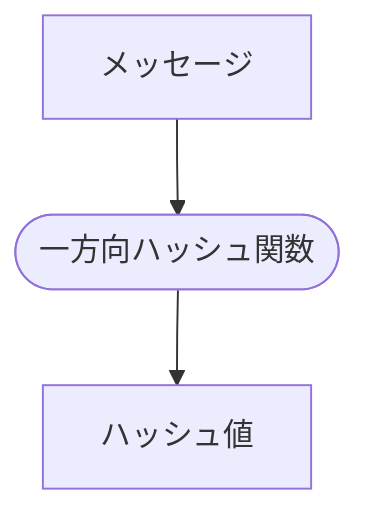
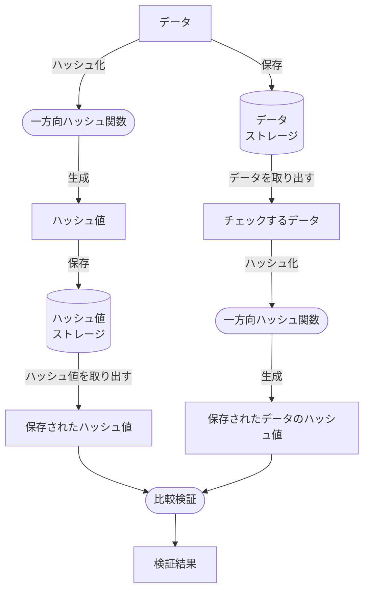

# 一方向ハッシュ関数(one-way hash function)

一方向性ハッシュ関数（または単にハッシュ関数）は、デジタルデータを任意の長さから固定長の出力に変換する暗号学的関数です。このハッシュ関数は、その計算から元のデータを再構築することが理論的に困難な「一方向性」の特性を持っています。

この関数を使用してファイルの「指紋」を生成します。
この指紋はハッシュ値と呼ばれ、ファイルやデータの内容が改ざんされていないかどうかを検証する際に利用されます。 ファイルやデータの正真性（完全性）を確認するために用いられるます。

例えば、2つのメッセージが等しいかどうかを調べるのに、メッセージを直接比較するのではなく、メッセージの指紋を比較する方法として用います。

TODO: パリティ、チェックサム、メッセージ認証コード、などの補足（別ページ）の作成

## 代表的な一方向ハッシュ関数

一方向ハッシュ関数には多くの種類があり、それぞれ異なる特性と用途を持っている。以下に代表的なハッシュ関数を示す。

| アルゴリズム | 出力長                 | RFC / 仕様                                                           | 状態                         |
| ------------ | ---------------------- | -------------------------------------------------------------------- | ---------------------------- |
| MD5          | 128 ビット             | [RFC 1321](https://datatracker.ietf.org/doc/html/rfc1321)            | 非推奨（衝突攻撃が発見済み） |
| SHA-1        | 160 ビット             | [RFC 3174](https://datatracker.ietf.org/doc/html/rfc3174)            | 非推奨（衝突攻撃が発見済み） |
| SHA-256      | 256 ビット             | [RFC 6234](https://datatracker.ietf.org/doc/html/rfc6234)            | 推奨                         |
| SHA-384      | 384 ビット             | [RFC 6234](https://datatracker.ietf.org/doc/html/rfc6234)            | 推奨                         |
| SHA-512      | 512 ビット             | [RFC 6234](https://datatracker.ietf.org/doc/html/rfc6234)            | 推奨                         |
| SHA-3        | 224/256/384/512 ビット | [FIPS 202](https://csrc.nist.gov/publications/detail/fips/202/final) | 推奨（Keccak ベース）        |
| RIPEMD-160   | 160 ビット             | -                                                                    | 限定的な用途（Bitcoin 等）   |
| BLAKE2       | 可変長                 | [RFC 7693](https://datatracker.ietf.org/doc/html/rfc7693)            | 推奨（高速）                 |
| BLAKE3       | 可変長                 | -                                                                    | 最新（並列処理に最適化）     |

## 目的

ハッシュ関数の目的を説明します。

1. **データの整合性の保証**:  
   ハッシュ関数は、データが変更されていないかどうかを確認するために使用されます。元のデータにわずかな変更が加えられても、生成されるハッシュ値は大きく異なるため（これを「アバランシュ効果」と言います）、データの完整性が保証されます。

2. **データの安全な保存**:  
   パスワードなどの機密情報は、そのハッシュ値を保存することで安全に保管することができます。これにより、元のデータが漏洩するリスクを減らしながら認証プロセスを安全に実行できます。

3. **データの識別**:  
   ハッシュ関数は、大量のデータから特定の項目を迅速に識別するために使用されます。例えば、ファイルのハッシュ値を比較することで、同じ内容のファイルを効率的に見つけることができます。

## 役割

ハッシュ関数の役割を説明します。

1. **デジタル署名**:  
   デジタル署名プロセスでは、ハッシュ関数がメッセージを固定長のダイジェストに変換し、そのダイジェストに秘密鍵を使用して署名が行われます。これにより、メッセージの改ざんを検出し、送信者の身元を確認することができます。

2. **データ構造の最適化**:  
   ハッシュ表などのデータ構造では、ハッシュ関数を使用してデータの格納位置を決定します。これにより、データの検索、挿入、削除を高速に行うことができます。

3. **認証プロセス**:  
   ハッシュ関数は、ユーザー認証プロセスでパスワードを保護するために使用されます。ユーザーが入力したパスワードをハッシュ化し、事前に保存されているハッシュ値と比較することで、パスワードの正当性を検証します。

4. **データの匿名化**:  
   データのプライバシーを保護するために、個人識別情報をハッシュ化することで匿名化します。これにより、データの利用や分析が可能になりながらも、個人のプライバシーは守られます。

以上のように、一方向性ハッシュ関数は暗号学的なセキュリティを提供すると同時に、データ管理と処理の効率化にも寄与しています。

## 用いられる用途

- ソフトウェアの改ざん検出
- パスワードを元にした暗号化
- メッセージ認証コード
- デジタル署名
- 擬似乱数生成期
- ワンタイムパスワード

## 主な特徴

- **入力（メッセージ）**：  
  テキスト、画像、バイナリデータなど、任意のデータを入力として受け付けます。このデータはビット列として扱われます。

- **出力（ハッシュ値）**：  
  入力データに基づいて計算された固定長の値。例えば、SHA-256 ハッシュ関数を使用した場合、出力は 256 ビット（32 バイト）の長さとなります。

## プロセス

メッセージが一方向ハッシュ関数を通じてハッシュ値に変換されるプロセスを示しています。どのような形式のデータでも、この関数によって一定の長さのハッシュ値が生成され、データの完全性を保証するために利用されます。



一方向ハッシュ関数はその計算速度の速さと、微小な入力の変化に対して出力が大きく変わる「アバランシュ効果(初期の状態が少しでも変わると、結果が著しく変わってしまう効果)」により、セキュリティ分野で広く信頼されています。

## 一方向ハッシュ関数の性質

一方向ハッシュ関数は以下のような性質により、データの検証、保護、認証のための基盤技術として、多くのセキュリティシステムで中核的な役割を果たしています。

### 1. 任意長のメッセージから固定長のハッシュ値を算出する

一方向ハッシュ関数は、どんな長さのデータでも受け取り、それを一定の長さを持つハッシュ値に変換します。この性質は、大量のデータや非常に短いデータであっても、ハッシュ値の長さが常に一定であることを保証します。これにより、データベースのインデックス作成、デジタル署名の生成、データの整合性検証など、多岐にわたる用途で利用することが可能です。

### 2. ハッシュ値を高速に計算できる

一方向ハッシュ関数は、計算が非常に高速であることが求められます。この性質は、大量のデータに対してリアルタイムでハッシュ値を生成する必要がある場面で特に重要です。例えば、ネットワーク通信のセキュリティを確保するために送信データのハッシュ値を素早く計算し、受信側で同様のハッシュ値を計算して整合性を確認するといったプロセスがあります。

### 3. メッセージが異なればハッシュ値も異なる

理想的な一方向ハッシュ関数では、たとえ入力データが微妙に異なるだけでも、出力されるハッシュ値は大きく異なるべきです（この性質を「アバランシュ効果」と言います）。これにより、オリジナルのデータを推測することが困難になり、セキュリティが強化されます。また、異なるメッセージから同じハッシュ値が生成されることを「衝突」といい、強力なハッシュ関数ではこの衝突の確率を極めて低く抑える必要があります。

### 4. 一方向性を持つ

ハッシュ値からメッセージを逆算できないという性質を持ちます。
例えば、パスワードなど元に戻すことで知られる可能性がないことなどに用いるときに重要な性質です。

## 一方向ハッシュ関数の利用プロセス

一方向ハッシュ関数を利用してデータの正真性を確認するプロセスを示します。



1. **データのハッシュ化**
   - 元のデータは一方向ハッシュ関数を通じてハッシュ化されます。
   - この関数はデータから固定長のハッシュ値を生成します。

2. **データとハッシュ値の保存**
   - 元のデータはデータストレージに保存されます。
   - 生成されたハッシュ値は別途、ハッシュ値ストレージに保存されます。

3. **データの検証プロセス**
   - 検証時には、データストレージからデータが取り出され（"チェックするデータ"）、再びハッシュ関数を用いてハッシュ化されます。
   - 同時に、ハッシュ値ストレージから元のハッシュ値（"保存されたハッシュ値"）が取り出されます。

4. **ハッシュ値の比較**
   - 新たに生成されたハッシュ値（"保存されたデータのハッシュ値"）と元のハッシュ値を比較します。
   - この比較は比較検証ステップで行われます。

5. **検証結果の出力**
   - 比較の結果、両者が一致すればデータは変更されていないと判断され、検証結果として正の結果が出力されます。
   - 一致しない場合は、データが何らかの形で改ざんされた可能性があると報告されます。

このプロセスにより、データの正真性が保証され、データの安全性が向上します。一方向ハッシュ関数の使用は、セキュリティが重要視される多くのシステムで重要な役割を果たします。

## 一方向ハッシュ関数の具体的な実例

現在最もポピュラーなハッシュ関数の一つは **SHA-256** を使用して任意のデータ（例えば文字列）のハッシュ値を生成するコマンドラインベースの例を示します。

### コマンドラインでのSHA-256ハッシュ生成例

```sh
% echo -n "Your Data Here" | openssl dgst -sha256
SHA2-256(stdin)= c83498500bac545738a3e40dc99c608549e151e330c28a8be8566aeea98afece
```

## ハッシュ関数のセキュリティ要件

暗号学的ハッシュ関数が安全であるためには、以下の要件を満たす必要がある。これらの要件は、ハッシュ関数の攻撃耐性を評価する際の基準となる。

| 要件                                       | 説明                                                                                        | 攻撃の難易度 |
| ------------------------------------------ | ------------------------------------------------------------------------------------------- | ------------ |
| 原像耐性（Preimage Resistance）            | ハッシュ値 h が与えられたとき、h = H(m) となる m を見つけることが困難                       | O(2^n)       |
| 第二原像耐性（Second Preimage Resistance） | メッセージ m1 が与えられたとき、H(m1) = H(m2) となる m2 (m1 \u2260 m2) を見つけることが困難 | O(2^n)       |
| 衝突耐性（Collision Resistance）           | H(m1) = H(m2) となる任意の異なるメッセージ m1, m2 のペアを見つけることが困難                | O(2^(n/2))   |

ここで n はハッシュ値のビット長を表す。衝突耐性は誕生日攻撃（Birthday Attack）により、O(2^(n/2)) の計算量で破られる可能性がある。

## SHA-2 ファミリーの詳細

SHA-2 は現在最も広く使用されているハッシュ関数ファミリーである。RFC 6234 で定義されており、以下のバリアントが存在する。

| アルゴリズム | 出力長     | ブロックサイズ | ワードサイズ | ラウンド数 |
| ------------ | ---------- | -------------- | ------------ | ---------- |
| SHA-224      | 224 ビット | 512 ビット     | 32 ビット    | 64         |
| SHA-256      | 256 ビット | 512 ビット     | 32 ビット    | 64         |
| SHA-384      | 384 ビット | 1024 ビット    | 64 ビット    | 80         |
| SHA-512      | 512 ビット | 1024 ビット    | 64 ビット    | 80         |
| SHA-512/224  | 224 ビット | 1024 ビット    | 64 ビット    | 80         |
| SHA-512/256  | 256 ビット | 1024 ビット    | 64 ビット    | 80         |

## ハッシュ関数の用途別推奨

用途に応じて適切なハッシュ関数を選択することが重要である。以下に推奨を示す。

| 用途                     | 推奨アルゴリズム       | 備考                        |
| ------------------------ | ---------------------- | --------------------------- |
| デジタル署名             | SHA-256 以上           | RFC 5280 で SHA-256 が推奨  |
| タイムスタンプ           | SHA-256 以上           | RFC 3161 準拠               |
| パスワードハッシュ       | Argon2, bcrypt, scrypt | 単純なハッシュ関数は不適切  |
| ファイル完全性検証       | SHA-256, BLAKE2        | 高速性が重要な場合は BLAKE2 |
| 証明書フィンガープリント | SHA-256                | SHA-1 は非推奨              |

## アルゴリズム移行の考慮事項

ハッシュアルゴリズムの安全性は時間とともに低下する可能性がある。以下の点を考慮してアルゴリズム移行計画を立てる必要がある。

| 考慮事項     | 説明                                                       |
| ------------ | ---------------------------------------------------------- |
| 暗号の危殆化 | 計算能力の向上や新たな攻撃手法の発見により安全性が低下する |
| 後方互換性   | 既存システムとの互換性を維持しながら移行する必要がある     |
| 長期保存     | 長期間保存するデータには、より安全なアルゴリズムを使用する |
| 規制要件     | 業界標準や法規制で要求されるアルゴリズムを確認する         |

## 関連 RFC・規格

一方向ハッシュ関数に関連する主要な RFC と規格を以下に示す。

| 規格                                                                     | タイトル                                                    | 説明                    |
| ------------------------------------------------------------------------ | ----------------------------------------------------------- | ----------------------- |
| [RFC 1321](https://datatracker.ietf.org/doc/html/rfc1321)                | The MD5 Message-Digest Algorithm                            | MD5 の仕様（非推奨）    |
| [RFC 3174](https://datatracker.ietf.org/doc/html/rfc3174)                | US Secure Hash Algorithm 1 (SHA1)                           | SHA-1 の仕様（非推奨）  |
| [RFC 6234](https://datatracker.ietf.org/doc/html/rfc6234)                | US Secure Hash Algorithms (SHA and SHA-based HMAC and HKDF) | SHA-2 ファミリーの仕様  |
| [RFC 7693](https://datatracker.ietf.org/doc/html/rfc7693)                | The BLAKE2 Cryptographic Hash and MAC                       | BLAKE2 の仕様           |
| [FIPS 180-4](https://csrc.nist.gov/publications/detail/fips/180/4/final) | Secure Hash Standard (SHS)                                  | NIST によるハッシュ標準 |
| [FIPS 202](https://csrc.nist.gov/publications/detail/fips/202/final)     | SHA-3 Standard                                              | SHA-3 (Keccak) の仕様   |
| [RFC 4055](https://datatracker.ietf.org/doc/html/rfc4055)                | Additional Algorithms for RSA with SHA                      | RSA 署名での SHA 使用   |

## 日本における法令との関係

ハッシュ関数は電子署名に不可欠な要素であり、日本の法令でも技術要件として規定されている。

| 法令                                                                           | 説明                                       |
| ------------------------------------------------------------------------------ | ------------------------------------------ |
| [電子署名法施行規則](https://elaws.e-gov.go.jp/document?lawid=413M60000418001) | 署名に使用するハッシュ関数の要件を規定     |
| [CRYPTREC 暗号リスト](https://www.cryptrec.go.jp/list.html)                    | 政府機関で使用可能な暗号アルゴリズムを規定 |

CRYPTREC では、SHA-256、SHA-384、SHA-512 が「電子政府推奨暗号リスト」に掲載されており、政府機関のシステムで使用が推奨されている。SHA-1 は「運用監視暗号リスト」に移行しており、新規システムでの使用は推奨されない
