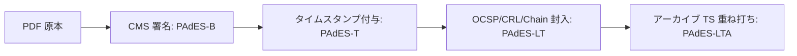
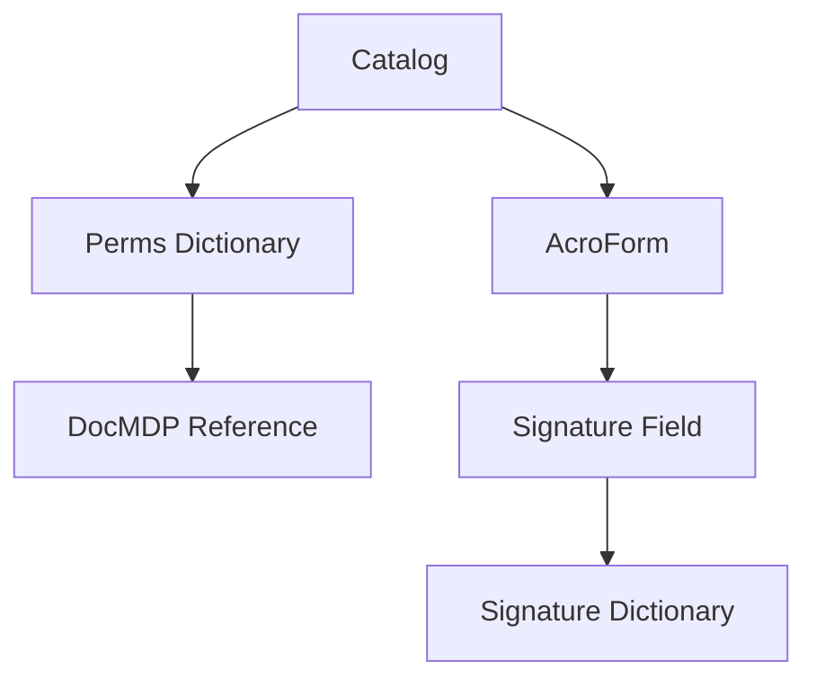

# PAdES (PDF Advanced Electronic Signatures)

PAdES（PDF Advanced Electronic Signatures）は、PDF ファイルに対する電子署名の標準規格である。EU の eIDAS 規制に準拠しており、文書の真正性、完全性、および署名者の同意を保証するために設計されている。

> 参照: [ETSI EN 319 142-1](https://www.etsi.org/deliver/etsi_en/319100_319199/31914201/01.01.01_60/en_31914201v010101p.pdf) - PAdES digital signatures

## PAdES の概要

PAdES は、PDF 文書に対する長期的に検証可能な電子署名を提供する。CAdES（CMS Advanced Electronic Signatures）を PDF に適用した形式であり、署名の長期保存と検証を可能にする。

### PAdES と関連規格の関係

PAdES は以下の規格と関連している。

| 規格              | 説明                               |
| ----------------- | ---------------------------------- |
| ETSI EN 319 142-1 | PAdES デジタル署名の基本仕様       |
| ETSI EN 319 142-2 | PAdES の追加仕様                   |
| ISO 32000-1/2     | PDF 仕様                           |
| RFC 3161          | タイムスタンププロトコル           |
| RFC 5652          | CMS (Cryptographic Message Syntax) |

## PAdES Baseline プロファイル

PAdES は段階的なプロファイルを提供し、用途に応じて適切なレベルを選択できる。

### プロファイル一覧

| プロファイル                       | 説明                                               | 用途                       |
| ---------------------------------- | -------------------------------------------------- | -------------------------- |
| PAdES-B (Basic)                    | CMS 署名（`adbe.pkcs7.detached`）を PDF に埋め込み | 基本的な署名               |
| PAdES-T (Timestamp)                | B に RFC 3161 タイムスタンプを追加                 | 署名時刻の証明が必要な場合 |
| PAdES-LT (Long Term)               | T に証明書連鎖と失効情報（OCSP/CRL）を封入         | オフライン検証が必要な場合 |
| PAdES-LTA (Long Term with Archive) | LT に長期アーカイブ用タイムスタンプを追加          | 10 年以上の長期保存        |

### プロファイル選択の目安

| 用途                  | 推奨プロファイル       |
| --------------------- | ---------------------- |
| 回覧・同意の署名      | PAdES-B または PAdES-T |
| 審査・監査対応        | PAdES-LT               |
| 長期保存（10 年以上） | PAdES-LTA              |

## PAdES の実装フロー

PAdES 署名の段階的な実装フローを以下に示す。



### 署名鍵の所在

署名鍵の保管場所によって実装方式が異なる。

| 方式             | 説明                                 |
| ---------------- | ------------------------------------ |
| クライアント署名 | ローカル証明書やスマートカードを使用 |
| リモート署名     | 署名トランザクション API を使用      |
| サーバ内署名     | QSCD/HSM を併用                      |

## PDF 署名の内部構造

PDF 署名は以下の要素から構成される。

### コア要素

| 要素                 | 説明                                   |
| -------------------- | -------------------------------------- |
| Signature Field      | 署名を保持するフォームフィールド       |
| Signature Dictionary | 署名の中身（署名値・範囲・メタデータ） |
| `/ByteRange`         | 署名計算対象のバイト範囲               |
| `/Contents`          | CMS 署名（DER/hex）                    |
| 増分更新             | 署名は追記で追加、既存は不変           |

### Signature Dictionary の構造

```
<< /Type /Sig
   /Filter /Adobe.PPKLite
   /SubFilter /adbe.pkcs7.detached
   /ByteRange [0 12345 23456 34567]
   /Contents <30820...>   % CMS (PKCS#7) Detached
   /M (D:20250823...)
   /Name (Signer Name)
>>
```

### PDF 署名の階層構造



## DSS (Document Security Store) と VRI

長期検証（LTV: Long Term Validation）に必要な情報を格納する構造。

### DSS の役割

| 要素 | 説明                                           |
| ---- | ---------------------------------------------- |
| DSS  | 長期検証用の格納庫（証明書・OCSP・CRL・TS 等） |
| VRI  | 署名ごとに必要な検証素材への索引               |

### DSS/VRI の概念構造

```
DSS <<
  /Certs [<DER cert1> <DER cert2> ...]
  /OCSPs [<DER ocsp1> ...]
  /CRLs  [<DER crl1> ...]
  /VRI <<
     /Sig1Hash <<
        /Cert [n 0 R ...]
        /OCSP [n 0 R ...]
        /CRL  [n 0 R ...]
        /TS   [n 0 R ...]
     >>
  >>
>>
```

## DocMDP と権限制御

PDF 署名には文書の変更を制御する機能がある。

### DocMDP レベル

| レベル | 説明                             |
| ------ | -------------------------------- |
| 1      | 変更不可（署名以外の変更を禁止） |
| 2      | フォーム入力と署名のみ許可       |
| 3      | 注釈とフォーム入力と署名を許可   |

## 実装チェックリスト

### PAdES-B

- [ ] PDF の署名対象範囲を `/ByteRange` で確定
- [ ] CMS（PKCS#7）Detached 署名（`/Contents`）を生成
- [ ] 署名後に PDF を増分更新（既存オブジェクトは変更しない）

### PAdES-T

- [ ] 署名コンテナ（CMS）にタイムスタンプトークン（TST）を付与
- [ ] TSA の信頼・時刻源・可用性を確認

### PAdES-LT

- [ ] 証明書連鎖（Signer → 中間 → ルート）を収集
- [ ] 各証明書の OCSP/CRL を取得し、PDF の DSS/VRI 辞書に封入
- [ ] オフラインでの検証が通ることを確認

### PAdES-LTA

- [ ] 文書全体に対してアーカイブ用 TS を追加
- [ ] 定期再封緘ポリシーを用意

## 検証要件

受け手で警告を出さないために確認すべき事項。

| 確認項目                    | 説明                                      |
| --------------------------- | ----------------------------------------- |
| 想定検証器での緑判定        | Acrobat / EU DSS / 企業内ビューワ等で検証 |
| 失効情報・連鎖の PDF 内完結 | LT/LTA では PDF 内に全て含める            |
| ルート信頼の戦略            | EUTL/AATL/社内信頼ストア等を事前に定義    |

## アルゴリズム選定

### 推奨アルゴリズム

| 用途     | 推奨アルゴリズム                  |
| -------- | --------------------------------- |
| 署名     | RSA-PSS または ECDSA（P-256/384） |
| ハッシュ | SHA-256 以上                      |

### 将来移行計画

アルゴリズム寿命に合わせて再タイムスタンプ／アーカイブ TS を付与する計画を立てる。

## よくある失敗パターン

| 問題                | 説明                                  |
| ------------------- | ------------------------------------- |
| `/ByteRange` の誤り | ギャップ長・順序の不整合              |
| 増分更新の破壊      | 署名後に PDF を再保存して破壊         |
| 失効情報の欠落      | OCSP/CRL が古いまたは欠落             |
| 外観と実体の不整合  | 可視署名の外観と `/Contents` が不整合 |

## 信頼プログラム

### 主要な信頼リスト

| 信頼リスト | 説明                                                |
| ---------- | --------------------------------------------------- |
| EUTL       | EU 各国の信頼サービス（認証局・TSA 等）の公式リスト |
| AATL       | Adobe 製品が既定で信頼するリスト                    |
| GPKI/JPKI  | 日本の政府系 PKI                                    |

### 信頼戦略の選択

| 配布先     | 推奨戦略                           |
| ---------- | ---------------------------------- |
| 不特定多数 | AATL/EUTL に載る TSP/TSA を利用    |
| 企業内限定 | 企業のルート配布（社内信頼ストア） |
| 官公庁連携 | GPKI 前提の検証器に合わせる        |

## テスト計画

### 検証方法

| 検証種別       | ツール                                  |
| -------------- | --------------------------------------- |
| 機械検証       | OpenSSL（CMS verify）、DSS CLI、pyHanko |
| ビューワ検証   | Acrobat / 企業標準ビューワ              |
| オフライン検証 | ネット遮断で LT/LTA が通るか確認        |

## 関連 RFC・規格

| 規格                                                                              | タイトル                  | 説明                           |
| --------------------------------------------------------------------------------- | ------------------------- | ------------------------------ |
| [ETSI EN 319 142-1](https://www.etsi.org/deliver/etsi_en/319100_319199/31914201/) | PAdES digital signatures  | PAdES の基本仕様               |
| [ETSI EN 319 142-2](https://www.etsi.org/deliver/etsi_en/319100_319199/31914202/) | PAdES extended signatures | PAdES の追加仕様               |
| [ISO 32000-2](https://www.iso.org/standard/75839.html)                            | PDF 2.0                   | PDF 仕様                       |
| [RFC 3161](https://datatracker.ietf.org/doc/html/rfc3161)                         | Time-Stamp Protocol (TSP) | タイムスタンププロトコル       |
| [RFC 5652](https://datatracker.ietf.org/doc/html/rfc5652)                         | CMS                       | 暗号メッセージ構文             |
| [RFC 6960](https://datatracker.ietf.org/doc/html/rfc6960)                         | OCSP                      | オンライン証明書状態プロトコル |
| [RFC 5280](https://datatracker.ietf.org/doc/html/rfc5280)                         | X.509 PKI                 | 証明書と CRL プロファイル      |
