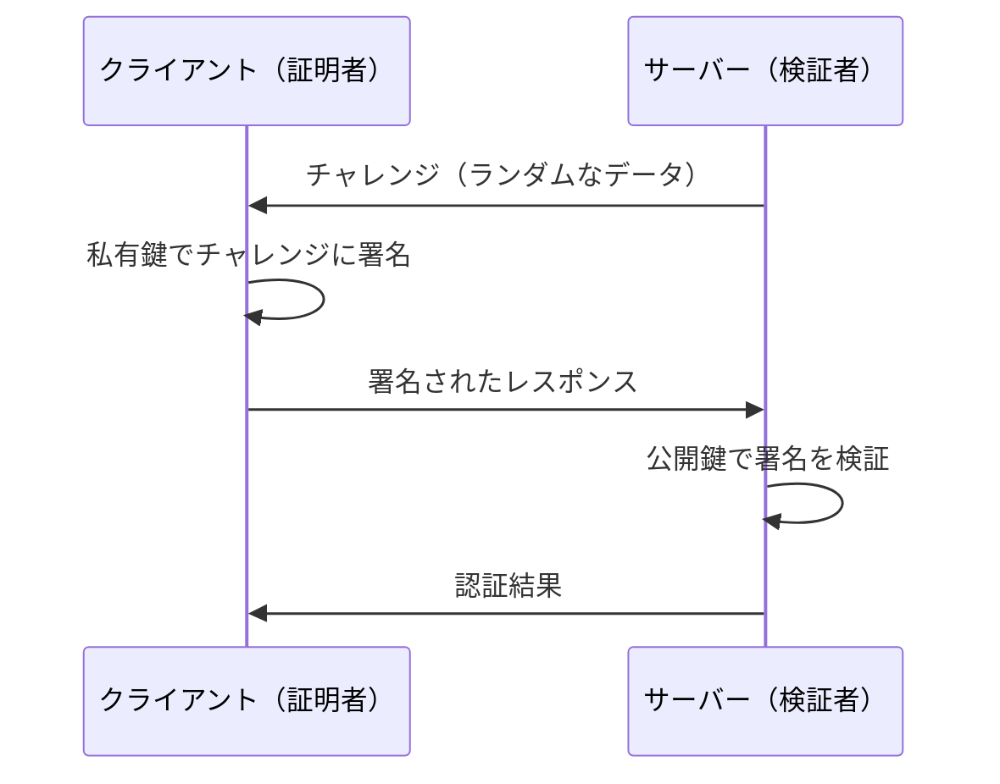
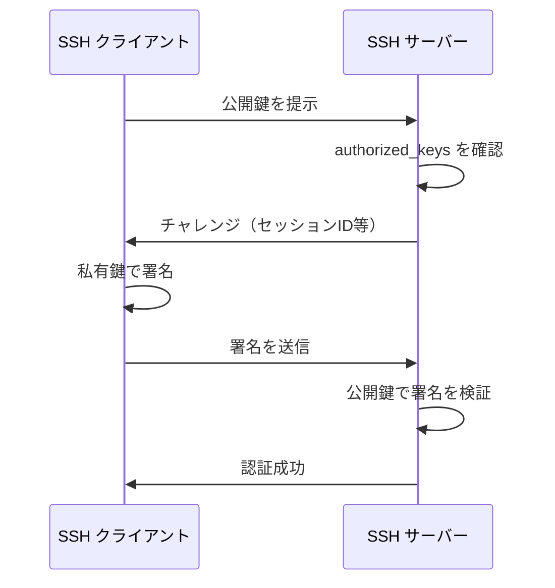
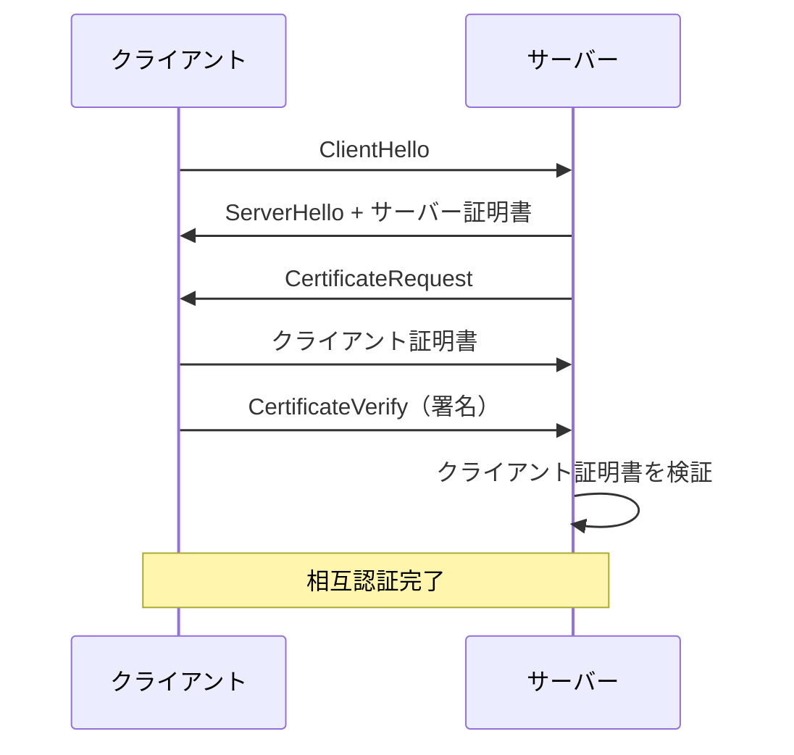
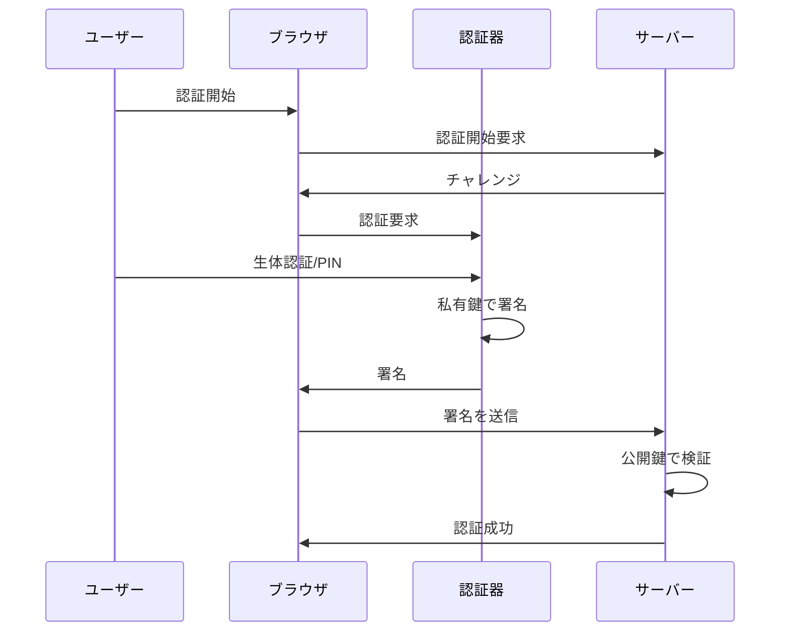
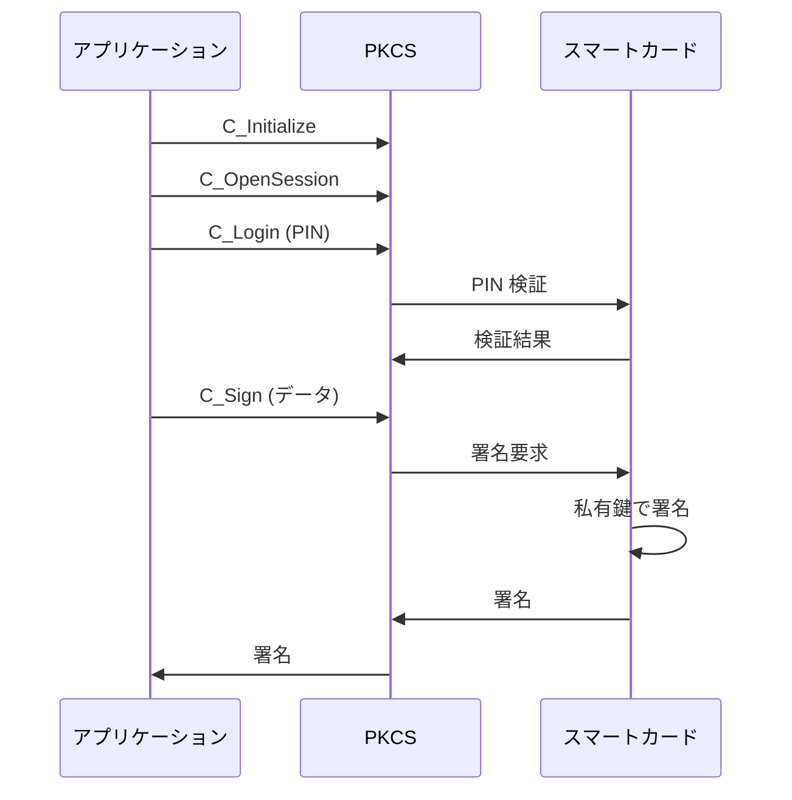

# 公開鍵認証（Public key authentication）

公開鍵認証は、公開鍵暗号方式を利用して通信相手の身元を確認する認証方式である。パスワード認証と異なり、秘密情報（私有鍵）をネットワーク上で送信する必要がないため、より安全な認証が可能である。

> 参照: [RFC 5280](https://datatracker.ietf.org/doc/html/rfc5280) - Internet X.509 Public Key Infrastructure Certificate and Certificate Revocation List (CRL) Profile

## 公開鍵認証の概要

公開鍵認証では、認証対象者が私有鍵を保持していることを、公開鍵を使って検証する。これにより、私有鍵を直接送信することなく、本人確認が可能となる。

### 認証の基本原理

公開鍵認証の基本的な仕組みは以下の通りである。

## 公開鍵認証の特徴

公開鍵認証には、パスワード認証と比較して以下の特徴がある。

| 項目             | 公開鍵認証                   | パスワード認証           |
| ---------------- | ---------------------------- | ------------------------ |
| 秘密情報の送信   | 不要（署名のみ送信）         | 必要（パスワードを送信） |
| リプレイ攻撃耐性 | チャレンジ-レスポンスで防止  | 対策が必要               |
| 中間者攻撃耐性   | 高い（私有鍵は送信されない） | 低い                     |
| 管理の複雑さ     | 鍵ペアの管理が必要           | パスワードの管理         |
| フィッシング耐性 | 高い                         | 低い                     |

## 公開鍵認証の方式

公開鍵認証には、用途に応じて複数の方式がある。

### 証明書ベースの認証

X.509 証明書を使用した認証方式で、TLS クライアント認証などで使用される。

| 要件レベル | 項目         | 説明                                                       |
| ---------- | ------------ | ---------------------------------------------------------- |
| MUST       | 証明書の提示 | クライアントは有効な証明書を提示しなければならない         |
| MUST       | 署名の検証   | サーバーは証明書の署名を検証しなければならない             |
| SHOULD     | 失効確認     | 証明書の失効状態を確認すべきである                         |
| MUST       | チェーン検証 | 証明書チェーンを信頼されたルートまで検証しなければならない |

### SSH 公開鍵認証

SSH プロトコルで使用される公開鍵認証方式（RFC 4252）。

### チャレンジ-レスポンス認証

一般的なチャレンジ-レスポンス方式の公開鍵認証。

| ステップ          | 説明                                     |
| ----------------- | ---------------------------------------- |
| 1. チャレンジ生成 | サーバーがランダムなチャレンジを生成     |
| 2. チャレンジ送信 | サーバーがクライアントにチャレンジを送信 |
| 3. 署名生成       | クライアントが私有鍵でチャレンジに署名   |
| 4. 署名送信       | クライアントがサーバーに署名を送信       |
| 5. 署名検証       | サーバーが公開鍵で署名を検証             |

## TLS クライアント認証

TLS プロトコルでは、相互認証（Mutual TLS / mTLS）として公開鍵認証が使用される。

### mTLS のフロー

### mTLS の要件（RFC 8446）

TLS 1.3 におけるクライアント認証の要件を以下に示す。

| 要件レベル | 項目              | 説明                                                                |
| ---------- | ----------------- | ------------------------------------------------------------------- |
| MUST       | CertificateVerify | クライアントは CertificateVerify メッセージを送信しなければならない |
| MUST       | 署名アルゴリズム  | サポートされるアルゴリズムで署名しなければならない                  |
| SHOULD     | 証明書チェーン    | 完全な証明書チェーンを送信すべきである                              |

## FIDO2/WebAuthn

最新の公開鍵認証標準として、FIDO2 と WebAuthn がある。パスワードレス認証を実現する技術である。

### WebAuthn のフロー

### FIDO2 の特徴

| 特徴             | 説明                                     |
| ---------------- | ---------------------------------------- |
| パスワードレス   | パスワードを使用しない認証が可能         |
| フィッシング耐性 | オリジン検証により偽サイトへの認証を防止 |
| プライバシー保護 | サービスごとに異なる鍵ペアを使用         |
| 多要素認証       | 所有（認証器）+ 知識（PIN）または 生体   |

## スマートカードによる認証

スマートカードを使用した公開鍵認証は、企業や政府機関で広く使用されている。

### スマートカード認証の構成

| コンポーネント   | 説明                                       |
| ---------------- | ------------------------------------------ |
| スマートカード   | 私有鍵を安全に格納するハードウェアトークン |
| カードリーダー   | スマートカードとの通信を行うデバイス       |
| ミドルウェア     | PKCS#11 等の API を提供するソフトウェア    |
| アプリケーション | 認証を行うアプリケーション                 |

### PKCS#11 による認証

PKCS#11 インターフェースを使用したスマートカード認証の流れ。

## 関連 RFC・規格

公開鍵認証に関連する主要な RFC と規格を以下に示す。

| 規格                                                                                  | タイトル                              | 説明                 |
| ------------------------------------------------------------------------------------- | ------------------------------------- | -------------------- |
| [RFC 5280](https://datatracker.ietf.org/doc/html/rfc5280)                             | X.509 PKI Certificate and CRL Profile | 証明書ベースの認証   |
| [RFC 4252](https://datatracker.ietf.org/doc/html/rfc4252)                             | SSH Authentication Protocol           | SSH 公開鍵認証       |
| [RFC 8446](https://datatracker.ietf.org/doc/html/rfc8446)                             | TLS 1.3                               | TLS クライアント認証 |
| [WebAuthn](https://www.w3.org/TR/webauthn-3/)                                         | Web Authentication                    | Web での公開鍵認証   |
| [FIDO2](https://fidoalliance.org/fido2/)                                              | FIDO2 Specifications                  | パスワードレス認証   |
| [PKCS#11](http://docs.oasis-open.org/pkcs11/pkcs11-base/v2.40/pkcs11-base-v2.40.html) | Cryptographic Token Interface         | トークン認証 API     |

## 日本における法令との関係

公開鍵認証は、以下の日本の法令・制度で利用されている。

| 法令・制度                                                             | 説明                               |
| ---------------------------------------------------------------------- | ---------------------------------- |
| [電子署名法](https://elaws.e-gov.go.jp/document?lawid=412AC0000000102) | 電子署名による本人確認の法的根拠   |
| [JPKI](https://www.jpki.go.jp/)                                        | マイナンバーカードによる公開鍵認証 |
| [e-Tax](https://www.e-tax.nta.go.jp/)                                  | 電子申告での公開鍵認証             |
| [電子入札](https://www.cals.jacic.or.jp/)                              | 公共調達での公開鍵認証             |

マイナンバーカードには、署名用電子証明書と利用者証明用電子証明書の2種類の証明書が格納されており、公開鍵認証に使用される
