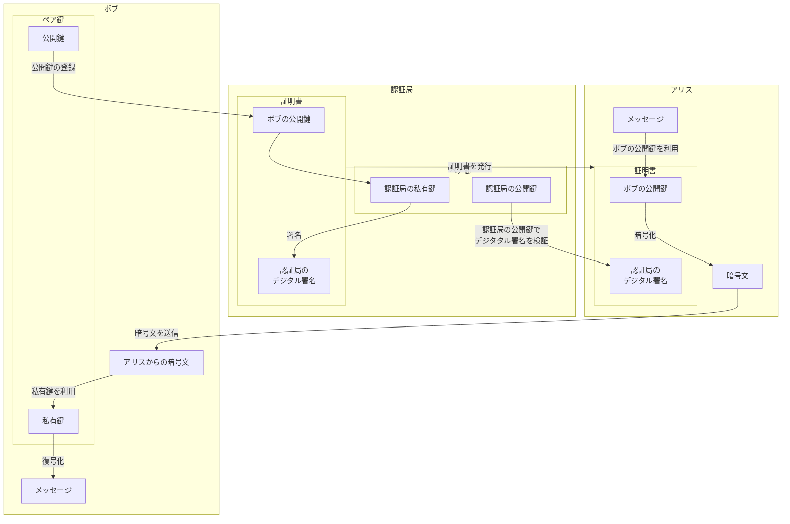
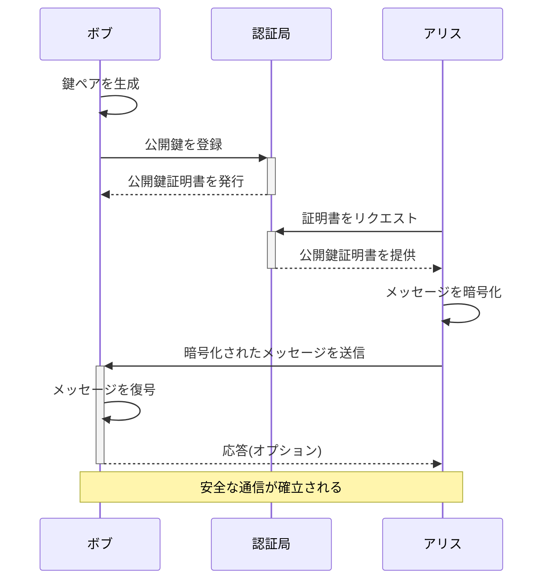
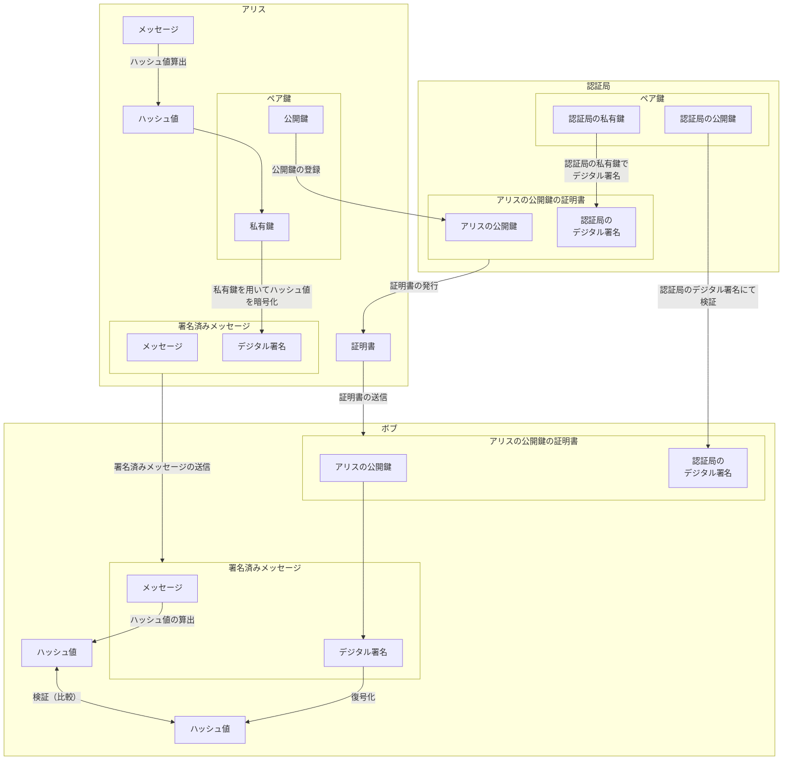
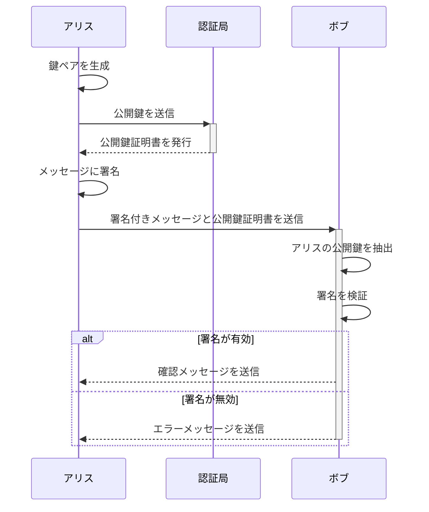

# 公開鍵証明書 (Public-key Certificate: PKC)

公開鍵が正しいものかどうかを証明するものが証明書である。
公開鍵へ（信用できる）第三者のデジタル署名を施すことにより、公開鍵が正しいものと証明する。

> 参照: [RFC 5280](https://datatracker.ietf.org/doc/html/rfc5280) - Internet X.509 Public Key Infrastructure Certificate and Certificate Revocation List (CRL) Profile

## 概要

公開鍵証明書とは、認証局（CA: Certification Authority）が発行する証明書で、「確かにこの公開鍵はこの人のものである」と証明するものである。これにより、通信の暗号化、データの整合性の確認、デジタル署名を通じた認証が可能となる。

| 要素       | 説明                                           |
| ---------- | ---------------------------------------------- |
| 主体者情報 | 登録者の名前、所属、メールアドレス等の識別情報 |
| 公開鍵     | 登録者の公開鍵と使用アルゴリズム               |
| 発行者署名 | 認証局（CA）によるデジタル署名                 |

## RFC 5280 - X.509 証明書プロファイル

RFC 5280 は、インターネット PKI で使用する X.509 v3 証明書と CRL のプロファイルを定義する。

### 準拠要件 (RFC 5280 Section 4)

RFC 5280 に準拠する認証局（CA）およびアプリケーションが満たすべき要件を以下に示す。

| 要件                 | レベル | 説明                                           |
| -------------------- | ------ | ---------------------------------------------- |
| v3 証明書のサポート  | MUST   | 準拠 CA は v3 証明書を発行できなければならない |
| 拡張フィールドの処理 | MUST   | critical 拡張を認識・処理できなければならない  |
| シリアル番号の一意性 | MUST   | 同一 issuer 内で一意でなければならない         |

> 参照: [RFC 5280 Section 4](https://datatracker.ietf.org/doc/html/rfc5280#section-4)

## Certificate 構造 (RFC 5280 Section 4.1)

### ASN.1 定義

```asn1
Certificate ::= SEQUENCE {
    tbsCertificate       TBSCertificate,
    signatureAlgorithm   AlgorithmIdentifier,
    signatureValue       BIT STRING
}

TBSCertificate ::= SEQUENCE {
    version         [0]  EXPLICIT Version DEFAULT v1,
    serialNumber         CertificateSerialNumber,
    signature            AlgorithmIdentifier,
    issuer               Name,
    validity             Validity,
    subject              Name,
    subjectPublicKeyInfo SubjectPublicKeyInfo,
    issuerUniqueID  [1]  IMPLICIT UniqueIdentifier OPTIONAL,
    subjectUniqueID [2]  IMPLICIT UniqueIdentifier OPTIONAL,
    extensions      [3]  EXPLICIT Extensions OPTIONAL
}

Version ::= INTEGER { v1(0), v2(1), v3(2) }

Validity ::= SEQUENCE {
    notBefore Time,
    notAfter  Time
}

Time ::= CHOICE {
    utcTime        UTCTime,
    generalTime    GeneralizedTime
}
```

### Certificate フィールド要件

Certificate 構造の各フィールドの要件を以下に示す。tbsCertificate が署名対象となる証明書本体である。

| フィールド         | 要件 | 説明                                              |
| ------------------ | ---- | ------------------------------------------------- |
| tbsCertificate     | MUST | 署名対象の証明書本体                              |
| signatureAlgorithm | MUST | tbsCertificate.signature と同一でなければならない |
| signatureValue     | MUST | CA による署名値                                   |

> 参照: [RFC 5280 Section 4.1](https://datatracker.ietf.org/doc/html/rfc5280#section-4.1)

## TBSCertificate フィールド詳細

TBSCertificate（To Be Signed Certificate）は証明書の署名対象となる本体部分である。各フィールドの詳細と要件を以下に示す。

| フィールド           | 要件                    | 説明                                                |
| -------------------- | ----------------------- | --------------------------------------------------- |
| version              | MUST（拡張使用時は v3） | v1(0), v2(1), v3(2)。拡張フィールド使用時は v3 必須 |
| serialNumber         | MUST                    | CA 内で一意な正の整数（最大 20 オクテット）         |
| signature            | MUST                    | 署名アルゴリズム識別子                              |
| issuer               | MUST                    | 発行者の DN（Distinguished Name）。空でない         |
| validity             | MUST                    | 有効期間（notBefore, notAfter）                     |
| subject              | MUST                    | 主体者の DN。CA 証明書では空でない                  |
| subjectPublicKeyInfo | MUST                    | 主体者の公開鍵とアルゴリズム                        |
| issuerUniqueID       | OPTIONAL                | 発行者の一意識別子（v2, v3 のみ、使用非推奨）       |
| subjectUniqueID      | OPTIONAL                | 主体者の一意識別子（v2, v3 のみ、使用非推奨）       |
| extensions           | OPTIONAL（v3 のみ）     | 拡張フィールド                                      |

### Validity の時刻形式

証明書の有効期間を表す時刻は、年代によって異なる形式でエンコードする必要がある。

| 年代        | 形式            | 要件                    |
| ----------- | --------------- | ----------------------- |
| 2049 年まで | UTCTime         | MUST（YYMMDDHHMMSSZ）   |
| 2050 年以降 | GeneralizedTime | MUST（YYYYMMDDHHMMSSZ） |

> 参照: [RFC 5280 Section 4.1.2](https://datatracker.ietf.org/doc/html/rfc5280#section-4.1.2)

## 証明書を利用するシナリオ（暗号文を送信する）

証明書を利用するシーンとして、暗号文を送信するシナリオを示します。

### 構成図

この図は、ボブが鍵ペアを作成し、その公開鍵を認証局に登録するところから、アリスが証明書を使って暗号文を送り、ボブがそれを複合するまでのプロセスを示しています。



1. **ボブ**:
   - **鍵ペア生成(公開鍵 & 私有鍵)**: ボブは自分の鍵ペアを生成します。
   - **私有鍵で複合**: ボブは受け取った暗号文を自分の私有鍵で複合します。
   - **複合した元の文書**: 複合された文書が出力されます。

2. **認証局**:
   - **公開鍵証明書を発行**: 認証局はボブの公開鍵と認証局のデジタル署名を含む証明書を発行します。

3. **アリス**:
   - **文書を暗号化**: アリスはボブの公開鍵を使って元の文書を暗号化し、ボブに送信します。

### シーケンス図

公開鍵証明書を利用し暗号化した通信のプロセスをシーケンス図で表現します。  
ボブが鍵ペアを生成し、公開鍵を認証局に登録して証明書を取得することから始まり、アリスが認証局から証明書を取得し、その公開鍵でメッセージを暗号化してボブに送信、ボブが私有鍵でメッセージを復号するまでの流れを示しています。



### シーケンス図の説明:

1. **ボブ**は自分の鍵ペア（公開鍵と私有鍵）を生成します。
2. **ボブは公開鍵を認証局に登録**: ボブが自分の公開鍵を認証局に送り、証明書の発行を依頼します。
3. **認証局はボブに公開鍵証明書を発行**: 認証局はボブの公開鍵に対してデジタル署名を行い、公開鍵証明書をボブに返します。
4. **アリスは認証局から証明書をリクエスト**: アリスが認証局からボブの公開鍵証明書をリクエストします。
5. **認証局はアリスに公開鍵証明書を提供**: 認証局からアリスにボブの公開鍵証明書が提供されます。
6. **アリスはメッセージを暗号化**: アリスは証明書内の公開鍵を使用してメッセージを暗号化します。
7. **アリスは暗号化されたメッセージをボブに送信**: 暗号化されたメッセージはボブに送信されます。
8. **ボブはメッセージを復号**: ボブは自分の私有鍵を使用してメッセージを復号します。
9. **オプションでボブはアリスに応答**: 応答が必要な場合、ボブはアリスに対して何らかの形で応答を送ることができます。

このシーケンス図を通じて、公開鍵証明書を利用した通信の手順と関連するアクションが明確に示されています。

## 証明書を利用するシナリオ（デジタル署名）

証明書を利用するシーンとして、メッセージにデジタル署名を行うシナリオを示します。

### 構成図

この図は、アリスがメッセージにデジタル署名を行い、認証局が発行した公開鍵証明書を利用し、ボブがその署名を検証するプロセスを示します。



1. **アリス**:
   - **鍵ペア生成(公開鍵 & 私有鍵)**: アリスは自分の鍵ペアを生成します。
   - **公開鍵の登録**: 認証局に公開鍵を登録します。
   - **メッセージのハッシュ値を算出**: メッセージのハッシュ値を算出します。
   - **メッセージにデジタル署名**: ハッシュ値を私有鍵で暗号化しデジタル署名を行い、メッセージに添付します。

2. **認証局**:
   - **公開鍵証明書を発行**: 認証局はアリスの公開鍵と認証局のデジタル署名を含む証明書を発行します。

3. **ボブ**:
   - **メッセージのハッシュ値を算出**: ボブはアリスからの署名済みメッセージからメッセージを取り出し、そのハッシュ値を算出します。
   - **アリスのデジタル署名を復号**: アリスの公開鍵の証明書の公開鍵より、アリスののデジタル署名の複合し得たハッシュ値を得ます。
   - **検証**: メッセージから算出したハッシュ値と、デジタル署名から得たハッシュ値が一致していることを確認し検証します。

### シーケンス図

公開鍵証明書を利用しメッセージにデジタル署名を行い、その署名を認証局が発行した証明書をもとに検証し、誰が発行したのかを確認するプロセスをシーケンス図で表現します。



### シーケンス図の説明:

1. **鍵ペアの生成**は公開鍵と私有鍵のペアを生成します。
2. **公開鍵の送信**: アリスは自分の公開鍵を認証局に送信します。
3. **公開鍵証明書の発行**: 認証局はアリスの公開鍵を受け取り、それにデジタル署名を施して公開鍵証明書を発行し、アリスに戻します。
4. **メッセージの署名**: アリスは自身の私有鍵を使用してメッセージにデジタル署名します。
5. **署名付きメッセージの送信**: アリスは署名付きメッセージと公開鍵証明書をボブに送信します。
6. **公開鍵の抽出と署名の検証**: ボブはアリスから受け取った公開鍵証明書からアリスの公開鍵を抽出し、その公開鍵でメッセージの署名を検証します。
7. **署名の検証結果に応じたアクション**: もし署名が有効であれば、ボブはアリスに確認メッセージを送信します。署名が無効であれば、エラーメッセージを送信します。

## デジタル署名証明書の種類

デジタル署名に使用される証明書は、主に電子メールの署名、コード署名、ドキュメント署名などに使用され、その信頼性は認証局（CA）による申請者の厳格な身元確認プロセスに基づいています。

### デジタル署名証明書の種類

| 種類                   | 用途                 | 説明                                                                                                                                   | 検証レベル                                                                                                                                        |
| ---------------------- | -------------------- | -------------------------------------------------------------------------------------------------------------------------------------- | ------------------------------------------------------------------------------------------------------------------------------------------------- |
| 個人認証証明書         | 個人用               | 個人の身元を確認し、個人がそのデジタル署名の責任者であることを証明するために使用されます                                               | 個人の身分証明書やその他の公的書類に基づくことが多い                                                                                              |
| 組織認証証明書         | 企業用               | 組織や企業の身元を確認し、その組織がデジタル署名の責任を持つことを証明するために使用されます                                           | 組織の合法性や実在性を確認するための詳細な調査が行われることがあります                                                                            |
| コード署名証明書       | ソフトウェアに署名   | ソフトウェア開発者が自分のアプリケーションやソフトウェアに署名するために使用されます                                                   | 署名されたコードの真正性と完整性をユーザーに保証する                                                                                              |
| ドキュメント署名証明書 | 電子文書             | PDFやその他のドキュメント形式の署名に使用されます                                                                                      | 署名されたドキュメントの内容が改ざんされていないことを保証。                                                                                      |
| TLS/SSL証明書          | サーバー証明         | ブラウザ、閲覧中の Web サイト、および Web サイトのサーバーの間で送信されるデータを暗号化することによってインターネット接続を保護します | それぞれの用途で認証レベルが異なります<ul><li>ドメイン認証（DV）証明書</li><li>企業認証（OV）証明書</li><li> EV（Extended Validation）証明書</ul> |
| 認証マーク証明書 (VMC) | メールマーケティング | BIMIと連携して企業のロゴをメールに表示し、受信者に企業の正当性を視覚的に保証するために使用されます                                     | 企業のブランド権利を確認し、ロゴが適切に表現されることを証明する                                                                                  |

### 認証レベルとプロセス

デジタル署名用の証明書では、申請者の身元確認の厳格さに応じて、異なるレベルの認証プロセスが適用されます。例えば、高い信頼性が求められる場合（金融取引や法的文書に使用される場合など）は、より厳格な身元確認と組織の実在性検証が必要になります。

デジタル署名証明書の種類や認証レベルは、使用する目的や必要とされる信頼度によって選ばれます。各認証局は異なる製品やサービスを提供しているため、特定のニーズに最も適した証明書を選択することが重要です。

## 標準拡張フィールド (RFC 5280 Section 4.2)

X.509 v3 証明書では、拡張フィールドにより追加情報を格納できる。

### 主要な拡張フィールド

| 拡張                         | OID               | Critical          | 説明                                        |
| ---------------------------- | ----------------- | ----------------- | ------------------------------------------- |
| Authority Key Identifier     | 2.5.29.35         | MUST NOT          | 発行者の鍵識別子                            |
| Subject Key Identifier       | 2.5.29.14         | MUST NOT          | 主体者の鍵識別子                            |
| Key Usage                    | 2.5.29.15         | SHOULD            | 鍵の使用目的                                |
| Extended Key Usage           | 2.5.29.37         | MAY               | 拡張鍵用途                                  |
| Basic Constraints            | 2.5.29.19         | MUST（CA 証明書） | CA フラグと pathLenConstraint               |
| Certificate Policies         | 2.5.29.32         | MAY               | 証明書ポリシー                              |
| Subject Alternative Name     | 2.5.29.17         | SHOULD NOT        | 主体者の代替名                              |
| CRL Distribution Points      | 2.5.29.31         | SHOULD NOT        | CRL 配布点                                  |
| Authority Information Access | 1.3.6.1.5.5.7.1.1 | MUST NOT          | CA 情報へのアクセス方法（OCSP, CA Issuers） |

### Key Usage ビット (RFC 5280 Section 4.2.1.3)

| ビット | 名前             | 説明                                             |
| ------ | ---------------- | ------------------------------------------------ |
| 0      | digitalSignature | デジタル署名（エンティティ認証、データ起源認証） |
| 1      | nonRepudiation   | 否認防止                                         |
| 2      | keyEncipherment  | 鍵暗号化（鍵交換用）                             |
| 3      | dataEncipherment | データ暗号化                                     |
| 4      | keyAgreement     | 鍵合意                                           |
| 5      | keyCertSign      | 証明書署名（CA のみ）                            |
| 6      | cRLSign          | CRL 署名                                         |
| 7      | encipherOnly     | 暗号化のみ（keyAgreement と併用）                |
| 8      | decipherOnly     | 復号のみ（keyAgreement と併用）                  |

### Extended Key Usage (RFC 5280 Section 4.2.1.12)

| OID               | 名前                  | 説明                       |
| ----------------- | --------------------- | -------------------------- |
| 1.3.6.1.5.5.7.3.1 | id-kp-serverAuth      | TLS サーバー認証           |
| 1.3.6.1.5.5.7.3.2 | id-kp-clientAuth      | TLS クライアント認証       |
| 1.3.6.1.5.5.7.3.3 | id-kp-codeSigning     | コード署名                 |
| 1.3.6.1.5.5.7.3.4 | id-kp-emailProtection | メール保護（S/MIME）       |
| 1.3.6.1.5.5.7.3.8 | id-kp-timeStamping    | タイムスタンプ（RFC 3161） |
| 1.3.6.1.5.5.7.3.9 | id-kp-OCSPSigning     | OCSP 署名                  |

> 参照: [RFC 5280 Section 4.2](https://datatracker.ietf.org/doc/html/rfc5280#section-4.2)

## X.509 証明書規格

公開鍵証明書の標準規格として最も一般的に用いられるのは「X.509」である。
X.509 証明書は、インターネットセキュリティで広く採用されており、SSL/TLS などのプロトコルで暗号化通信を安全に行うために使用されている。

### X.509 証明書の主要フィールド

| フィールド           | RFC 5280 Section | 説明                                 |
| -------------------- | ---------------- | ------------------------------------ |
| version              | 4.1.2.1          | 証明書のバージョン番号（v1, v2, v3） |
| serialNumber         | 4.1.2.2          | 証明書を一意に識別する番号           |
| signature            | 4.1.2.3          | 署名に使用されたアルゴリズム         |
| issuer               | 4.1.2.4          | 証明書を発行した CA の DN            |
| validity             | 4.1.2.5          | 有効期間（notBefore, notAfter）      |
| subject              | 4.1.2.6          | 証明書所有者の DN                    |
| subjectPublicKeyInfo | 4.1.2.7          | 公開鍵とアルゴリズム                 |
| issuerUniqueID       | 4.1.2.8          | 発行者の一意識別子（非推奨）         |
| subjectUniqueID      | 4.1.2.8          | 主体者の一意識別子（非推奨）         |
| extensions           | 4.1.2.9          | 拡張フィールド（v3 のみ）            |

### X.509 証明書の仕様

X.509 証明書は、Web サーバーやメールサーバーなど、インターネット上のさまざまなサービスでクライアントとサーバー間の身元確認やデータの暗号化に使用されます。SSL/TLS プロトコルでの安全な通信を確立するために、クライアント（たとえば Web ブラウザ）はサーバーから証明書を受け取り、その証明書が信頼できる認証局によって発行されたものであるかを確認します。

X.509 証明書は、その堅牢性と標準化されたフォーマットにより、デジタル認証の基盤として広く採用されています。この規格を通じて、ユーザーは暗号化された通信の信頼性とセキュリティを保証されます。

### X.509 証明書の構造

<table>
  <tr>
    <td rowspan="16">証明書</td>
    <td rowspan="14">署名前証明書</td>
    <td colspan="2">バージョン（Version）</td>
  </tr>
  <tr>
    <td colspan="2">シリアル番号</td>    
  </tr>
  <tr>
    <td colspan="2">アルゴリズム識別子</td>    
  </tr>
  <tr>
    <td colspan="2">発行者</td>    
  </tr>
  <tr>
    <td rowspan="2">有効期限</td>
    <td>開始時刻</td>
  </tr>
  <tr>
    <td>終了時刻</td>    
  </tr>
  <tr>
    <td colspan="2">主体者</td>    
  </tr>
  <tr>
    <td rowspan="2">主体者公開鍵情報</td>
    <td>アルゴリズム</td>
  </tr>
  <tr>
    <td>主体者公開鍵</td>    
  </tr>
  <tr>
    <td colspan="2">発行者ユニーク識別番号</td>    
  </tr>
  <tr>
    <td colspan="2">主体者ユニーク識別番号</td>    
  </tr>
  <tr>
    <td rowspan="3">拡張領域</td>
    <td>識別子</td>
  </tr>
  <tr>
    <td>重要度</td>    
  </tr>
  <tr>
    <td>拡張値</td>    
  </tr>
  <tr>
    <td colspan="3">署名アルゴリズム</td>    
  </tr>
  <tr>
    <td colspan="3">署名値</td>    
  </tr>
</table>

#### 構造の説明

<table>
  <tr>
    <th>証明書のセクション</th>
    <th>サブセクション</th>
    <th>詳細</th>
  </tr>
  <tr>
    <td rowspan="3">署名前証明書</td>
    <td>バージョン（Version）</td>
    <td>証明書のバージョン番号（例：Version 3）</td>
  </tr>
  <tr>
    <td>シリアル番号（Serial Number）</td>
    <td>証明書の一意の識別子</td>
  </tr>
  <tr>
    <td>アルゴリズム識別子（Signature Algorithm ID）</td>
    <td>証明書の署名に使用されたアルゴリズム</td>
  </tr>
  <tr>
    <td rowspan="2">発行者（Issuer）</td>
    <td>名前</td>
    <td>証明書を発行した認証局（CA）の名前</td>
  </tr>
  <tr>
    <td>発行者ユニーク識別番号（Optional）</td>
    <td>X.509バージョン2以降で使用可能な識別子</td>
  </tr>
  <tr>
    <td rowspan="2">有効期限（Validity）</td>
    <td>開始時刻（Not Before）</td>
    <td>証明書の有効開始日時</td>
  </tr>
  <tr>
    <td>終了時刻（Not After）</td>
    <td>証明書の有効終了日時</td>
  </tr>
  <tr>
    <td rowspan="3">主体者（Subject）</td>
    <td>名前</td>
    <td>証明書の所有者の識別情報</td>
  </tr>
  <tr>
    <td>主体者公開鍵情報（Public Key Info）</td>
    <td>公開鍵とそのアルゴリズム</td>
  </tr>
  <tr>
    <td>主体者ユニーク識別番号（Optional）</td>
    <td>X.509バージョン2以降で使用可能な識別子</td>
  </tr>
  <tr>
    <td rowspan="3">拡張領域（Extensions）</td>
    <td>識別子（Identifier）</td>
    <td>拡張の一意の識別子</td>
  </tr>
  <tr>
    <td>重要度（Critical）</td>
    <td>この拡張がクリティカルであるかどうか</td>
  </tr>
  <tr>
    <td>拡張値（Value）</td>
    <td>拡張に含まれる具体的な情報または値</td>
  </tr>
  <tr>
    <td>署名アルゴリズム（Signature Algorithm）</td>
    <td colspan="2">証明書の署名に使用されたアルゴリズムの詳細</td>
  </tr>
  <tr>
    <td>署名値（Signature）</td>
    <td colspan="2">認証局（CA）によるデジタル署名</td>
  </tr>
</table>

## SSL証明書のライフサイクルの自動化

> [!CAUTION]
> これらはあくまで、TLS/SSLの証明書発行の自動化手続きです。
> デジタル署名での利用では、一般的ではありません。

SCEP、EST、ACME は主に証明書の発行と管理に焦点を当てたプロトコルで、証明書の発行、更新、管理を自動化するために設計されています。これらは特に以下のようなシナリオで使用されます。

1. **証明書発行手続きの自動化**:
   - これらのプロトコルは、公開鍵証明書を要求し、取得する過程を自動化します。例えば、新しいデバイスやサービスがデプロイされたときに、証明書を自動的に取得し、セキュリティを確保するための初期セットアップを行います。

2. **公開鍵を利用したいエンドユーザーやシステムの支援**:
   - 公開鍵を使用するエンドユーザー（暗号化の場合は送信者、デジタル署名の場合は受信者）やシステムは、これらのプロトコルを通じて、必要に応じて自動的に公開鍵証明書を取得または更新することができます。例えば、ウェブサーバが SSL/TLS 証明書を自動的に取得して安全な通信を保証するために ACME プロトコルを利用する場合などです。

### 各プロトコルの特徴と利用シナリオ

- **SCEP (Simple Certificate Enrollment Protocol)**:
  - 主にネットワークデバイスやモバイルデバイスが多い環境で使われます。CA からの証明書の自動発行と更新が行えるため、大規模な IT インフラストラクチャでの管理を容易にします。

- **EST (Enrollment over Secure Transport)**:
  - EST は HTTPS を利用して証明書の要求を安全に行います。これは SCEP のより安全な代替として開発され、特に企業環境やセキュリティが重視される環境での使用が推奨されます。

- **ACME (Automated Certificate Management Environment)**:
  - ウェブサーバなどのインターネット向けサービスで広く使用されています。特に、Let's Encrypt などの CA では、ACME を使用して無料の SSL/TLS 証明書を提供し、ウェブのセキュリティを大幅に向上させています。

これらのプロトコルは、TLS/SSLの証明書のライフサイクルを自動化し、証明書の取得から更新、時には取り消しまでを効率的に管理するために重要な役割を果たしています。エンドユーザーやシステムはこれらのプロトコルを利用して、必要なセキュリティ認証を自動的に処理し、運用の効率化とセキュリティの向上を図ることができます。

## 関連 RFC

| RFC                                                       | タイトル                                       | 説明                           |
| --------------------------------------------------------- | ---------------------------------------------- | ------------------------------ |
| [RFC 5280](https://datatracker.ietf.org/doc/html/rfc5280) | Internet X.509 PKI Certificate and CRL Profile | 本文書の主要参照               |
| [RFC 6960](https://datatracker.ietf.org/doc/html/rfc6960) | X.509 OCSP                                     | オンライン証明書状態プロトコル |
| [RFC 5652](https://datatracker.ietf.org/doc/html/rfc5652) | Cryptographic Message Syntax (CMS)             | 暗号メッセージ構文             |
| [RFC 3161](https://datatracker.ietf.org/doc/html/rfc3161) | Time-Stamp Protocol (TSP)                      | タイムスタンププロトコル       |
| [RFC 4210](https://datatracker.ietf.org/doc/html/rfc4210) | Certificate Management Protocol (CMP)          | 証明書管理プロトコル           |
| [RFC 7030](https://datatracker.ietf.org/doc/html/rfc7030) | Enrollment over Secure Transport (EST)         | セキュアトランスポート上の登録 |
| [RFC 8555](https://datatracker.ietf.org/doc/html/rfc8555) | ACME Protocol                                  | 自動証明書管理環境             |
| [RFC 2119](https://datatracker.ietf.org/doc/html/rfc2119) | Key words for RFCs                             | MUST/SHOULD/MAY の定義         |

## 関連法令

### 電子署名法（平成十二年法律第百二号）

電子署名及び認証業務に関する法律において、電子署名の定義と法的効力が規定されている。

> 詳細: [e-Gov 法令検索 - 電子署名法](https://laws.e-gov.go.jp/law/412AC0000000102)
