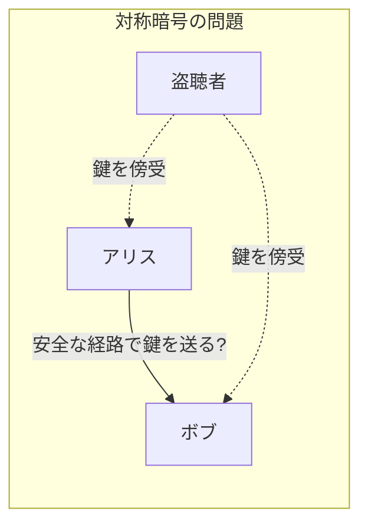
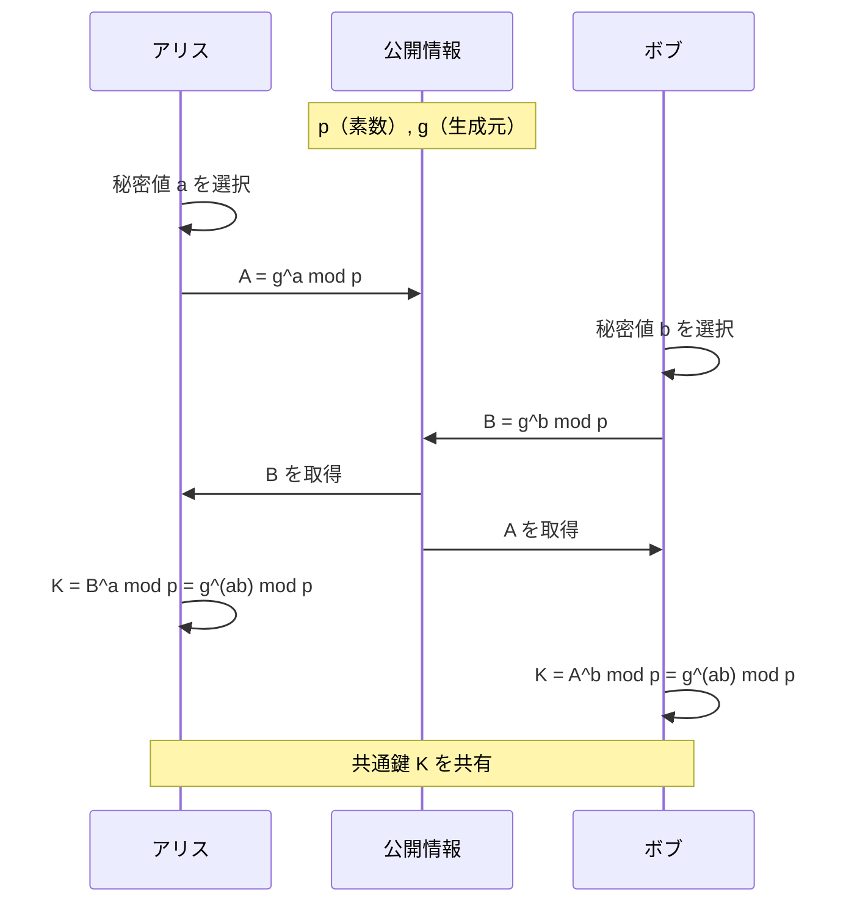
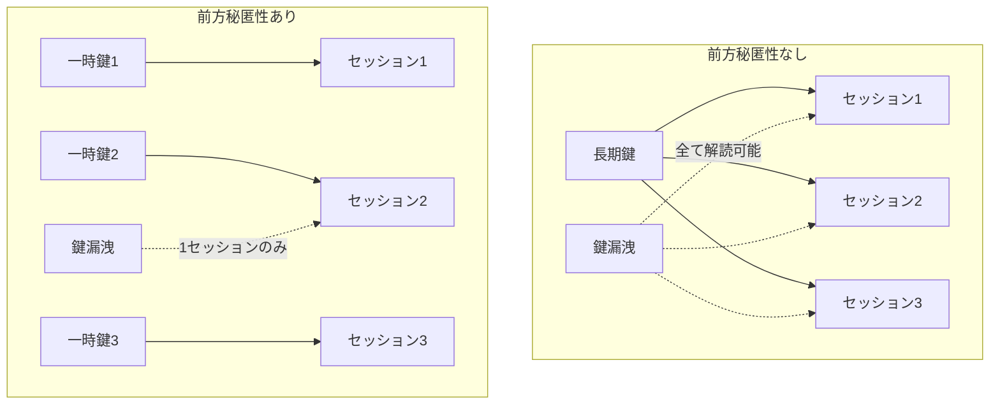
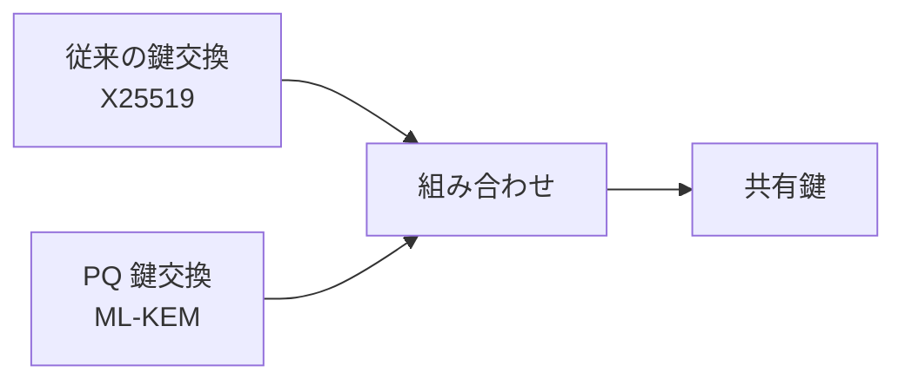

# 公開鍵鍵交換（Public Key Exchange）

公開鍵鍵交換は、通信を行う二者間で安全に共通鍵を確立するための技術である。公開鍵暗号方式を利用することで、盗聴者がいる通信路上でも安全に鍵を共有できる。

> 参照: [RFC 7748](https://datatracker.ietf.org/doc/html/rfc7748) - Elliptic Curves for Security (X25519, X448)

## 鍵交換の概要

鍵交換は、通信の機密性を確保するための基盤技術である。対称暗号は高速だが、事前に鍵を共有する必要がある。公開鍵鍵交換は、この「鍵配送問題」を解決する。

### 鍵配送問題

対称暗号を使用する場合、以下の問題が生じる。

| 問題           | 説明                                       |
| -------------- | ------------------------------------------ |
| 鍵の事前共有   | 通信前に安全な方法で鍵を共有する必要がある |
| 鍵の管理       | n 人の通信には n(n-1)/2 個の鍵が必要       |
| 鍵の漏洩リスク | 鍵が漏洩すると過去の通信も解読される       |



## Diffie-Hellman 鍵交換

Diffie-Hellman（DH）鍵交換は、最も基本的な公開鍵鍵交換プロトコルである。1976 年に提案され、現在も広く使用されている。

### DH 鍵交換の原理

DH 鍵交換は、離散対数問題の困難性に基づいている。



### DH パラメータの要件

安全な DH 鍵交換を行うためのパラメータ要件を以下に示す。

| 要件レベル | 項目             | 説明                                               |
| ---------- | ---------------- | -------------------------------------------------- |
| MUST       | 素数 p           | 安全素数（(p-1)/2 も素数）を使用しなければならない |
| MUST       | ビット長         | 2048 ビット以上を使用しなければならない            |
| SHOULD     | 検証済みグループ | RFC 7919 で定義されたグループを使用すべきである    |
| MUST NOT   | 弱いパラメータ   | 1024 ビット以下のパラメータを使用してはならない    |

## 楕円曲線 Diffie-Hellman（ECDH）

ECDH は、楕円曲線暗号を使用した DH 鍵交換である。従来の DH より短い鍵長で同等のセキュリティを実現できる。

### ECDH の鍵長比較

同等のセキュリティレベルを達成するための鍵長を比較する。

| セキュリティレベル | DH/RSA       | ECDH       | 備考             |
| ------------------ | ------------ | ---------- | ---------------- |
| 112 ビット         | 2048 ビット  | 224 ビット | 短期利用         |
| 128 ビット         | 3072 ビット  | 256 ビット | 推奨             |
| 192 ビット         | 7680 ビット  | 384 ビット | 高セキュリティ   |
| 256 ビット         | 15360 ビット | 521 ビット | 最高セキュリティ |

### 推奨楕円曲線

RFC と NIST で推奨される楕円曲線を以下に示す。

| 曲線   | RFC                                                       | 鍵長       | 説明                   |
| ------ | --------------------------------------------------------- | ---------- | ---------------------- |
| X25519 | [RFC 7748](https://datatracker.ietf.org/doc/html/rfc7748) | 256 ビット | 高速、安全、実装が容易 |
| X448   | [RFC 7748](https://datatracker.ietf.org/doc/html/rfc7748) | 448 ビット | より高いセキュリティ   |
| P-256  | [RFC 5639](https://datatracker.ietf.org/doc/html/rfc5639) | 256 ビット | NIST 推奨、広く普及    |
| P-384  | [RFC 5639](https://datatracker.ietf.org/doc/html/rfc5639) | 384 ビット | 高セキュリティ用途     |

## TLS における鍵交換

TLS プロトコルでは、複数の鍵交換方式がサポートされている。

### TLS 1.3 の鍵交換

TLS 1.3（RFC 8446）では、以下の鍵交換方式が定義されている。

| 方式          | 説明                                    | 要件           |
| ------------- | --------------------------------------- | -------------- |
| ECDHE         | 楕円曲線 Diffie-Hellman（エフェメラル） | MUST support   |
| DHE           | 有限体 Diffie-Hellman（エフェメラル）   | SHOULD support |
| PSK           | 事前共有鍵                              | MAY support    |
| PSK + (EC)DHE | PSK と DH の組み合わせ                  | MAY support    |

### 前方秘匿性（Forward Secrecy）

エフェメラル鍵交換（ECDHE、DHE）は、前方秘匿性を提供する。

| 項目           | 静的鍵交換           | エフェメラル鍵交換             |
| -------------- | -------------------- | ------------------------------ |
| 鍵の使用       | 固定の鍵ペアを使用   | セッションごとに新しい鍵を生成 |
| 鍵の漏洩影響   | 過去の通信も解読可能 | 過去の通信は保護される         |
| 前方秘匿性     | なし                 | あり                           |
| パフォーマンス | 高速                 | やや低速                       |



## 鍵交換の要件（RFC 8446）

TLS 1.3 における鍵交換の要件を以下に示す。

### サポートすべき曲線

| 要件レベル | 曲線              | 説明         |
| ---------- | ----------------- | ------------ |
| MUST       | secp256r1 (P-256) | 必須サポート |
| SHOULD     | x25519            | 推奨         |
| MAY        | secp384r1 (P-384) | オプション   |
| MAY        | x448              | オプション   |

### 禁止事項

| 要件レベル | 項目            | 説明                                   |
| ---------- | --------------- | -------------------------------------- |
| MUST NOT   | 静的 RSA        | RSA 鍵交換を使用してはならない         |
| MUST NOT   | 静的 DH         | 静的 DH 鍵交換を使用してはならない     |
| MUST NOT   | 1024 ビット以下 | 弱い DH パラメータを使用してはならない |

## 鍵共有の実装例

OpenSSL を使用した X25519 鍵交換の例を示す。

### 鍵ペアの生成

```bash
# アリスの鍵ペア生成
openssl genpkey -algorithm X25519 -out alice_private.pem
openssl pkey -in alice_private.pem -pubout -out alice_public.pem

# ボブの鍵ペア生成
openssl genpkey -algorithm X25519 -out bob_private.pem
openssl pkey -in bob_private.pem -pubout -out bob_public.pem
```

### 共有秘密の導出

```bash
# アリスが共有秘密を計算
openssl pkeyutl -derive -inkey alice_private.pem -peerkey bob_public.pem -out alice_shared.bin

# ボブが共有秘密を計算
openssl pkeyutl -derive -inkey bob_private.pem -peerkey alice_public.pem -out bob_shared.bin

# 両者の共有秘密が一致することを確認
diff alice_shared.bin bob_shared.bin
```

## ポスト量子鍵交換

量子コンピュータの脅威に対応するため、ポスト量子鍵交換アルゴリズムの標準化が進んでいる。

### NIST PQC 標準化

| アルゴリズム       | 種類             | 状態                  |
| ------------------ | ---------------- | --------------------- |
| ML-KEM (Kyber)     | 格子暗号         | FIPS 203 として標準化 |
| ML-DSA (Dilithium) | 格子暗号（署名） | FIPS 204 として標準化 |

### ハイブリッド鍵交換

移行期間中は、従来の鍵交換とポスト量子鍵交換を組み合わせるハイブリッド方式が推奨される。



## 関連 RFC・規格

鍵交換に関連する主要な RFC と規格を以下に示す。

| 規格                                                      | タイトル                            | 説明               |
| --------------------------------------------------------- | ----------------------------------- | ------------------ |
| [RFC 2631](https://datatracker.ietf.org/doc/html/rfc2631) | Diffie-Hellman Key Agreement Method | DH 鍵交換          |
| [RFC 7748](https://datatracker.ietf.org/doc/html/rfc7748) | Elliptic Curves for Security        | X25519, X448       |
| [RFC 7919](https://datatracker.ietf.org/doc/html/rfc7919) | Negotiated Finite Field DH          | TLS 用 DH グループ |
| [RFC 8446](https://datatracker.ietf.org/doc/html/rfc8446) | TLS 1.3                             | TLS での鍵交換     |
| [RFC 5639](https://datatracker.ietf.org/doc/html/rfc5639) | ECC Brainpool Curves                | Brainpool 曲線     |
| [RFC 8031](https://datatracker.ietf.org/doc/html/rfc8031) | Curve25519/448 for IKEv2            | IPsec での X25519  |

## 日本における関連規格

鍵交換は、以下の日本の規格・ガイドラインで言及されている。

| 規格・ガイドライン                                                             | 説明                                         |
| ------------------------------------------------------------------------------ | -------------------------------------------- |
| [CRYPTREC 暗号リスト](https://www.cryptrec.go.jp/list.html)                    | 政府機関で使用可能な鍵交換アルゴリズムを規定 |
| [IPA セキュアプログラミング](https://www.ipa.go.jp/security/vuln/websecurity/) | 安全な鍵交換の実装ガイドライン               |

CRYPTREC では、ECDH（P-256、P-384）と DH（2048 ビット以上）が「電子政府推奨暗号リスト」に掲載されている
