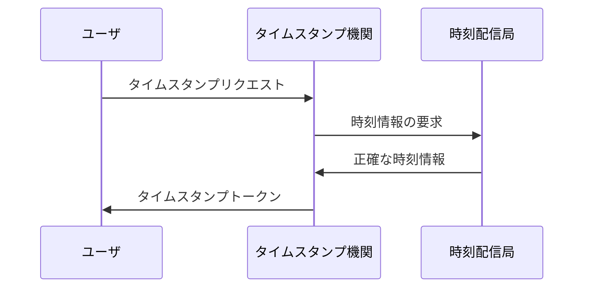
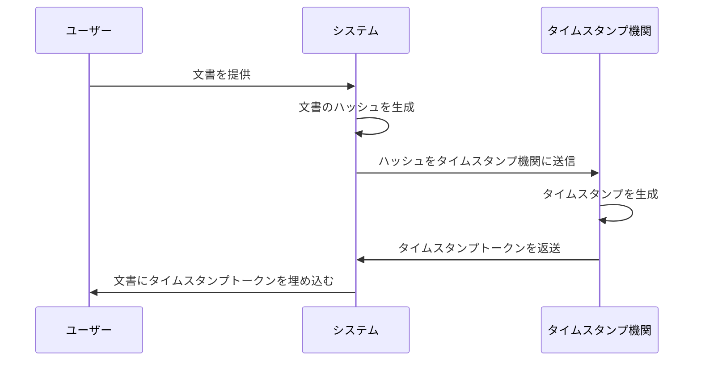
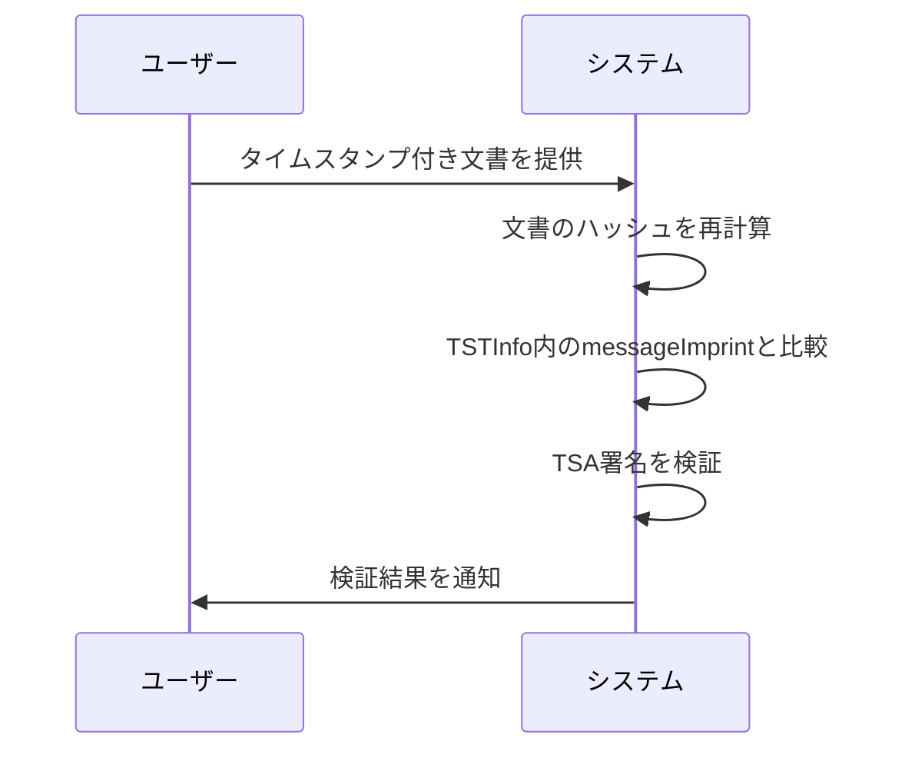

# タイムスタンプ (Time Stamp)

ここでは、タイムスタンプサービス（TSA）を利用し、電子文書やデータに付与するタイムスタンプを対象としている。
一般的な意味のタイムスタンプ（ファイルなどの作成日時や、更新日時、通信ログ、ログイン、アクセス試行、権限昇格などセキュリティイベントの記録など）ではないことに留意すること。

> 参照: [RFC 3161](https://datatracker.ietf.org/doc/html/rfc3161) - Internet X.509 PKI Time-Stamp Protocol (TSP)

## タイムスタンプとは

タイムスタンプは、その施された文書やデータに対して、以下の 2 つを証明するものである。

| 証明         | 説明                                                                           | RFC 参照             |
| ------------ | ------------------------------------------------------------------------------ | -------------------- |
| 存在証明     | タイムスタンプに刻印されている時刻以前に、その電子文書が存在していたことを証明 | RFC 3161 Section 2.1 |
| 非改ざん証明 | タイムスタンプに刻印されている時刻以降、当該文書が改ざんされていないことを証明 | RFC 3161 Section 2.1 |

つまり、タイムスタンプを文書やデータに施すことで、以下の 2 つを保証する。

- **「いつ」** その文書やデータが作成または変更されたかを証明
- **「何を」** その文書やデータに含まれているかを証明

これにより、タイムスタンプを施された文書やデータは、その信頼性や完全性を確保し、後での紛争や訴訟の際に有益な証拠となりうる。

## 時刻認証局 (TSA: Time-Stamping Authority)

タイムスタンプを発行する機関を、時刻認証局（TSA: Time-Stamping Authority）という。
信頼できる第三者（TTP: Trusted Third Party）であることが重要である。

### TSA の要件 (RFC 3161 Section 2.1)

RFC 3161 で定義される TSA の要件を以下に示す。これらの要件を満たすことで、タイムスタンプの信頼性が保証される。

| 要件                                               | レベル   | 説明                                           |
| -------------------------------------------------- | -------- | ---------------------------------------------- |
| 信頼できる時刻源の使用                             | MUST     | TSA は信頼できる時刻源を使用しなければならない |
| 各タイムスタンプトークンに信頼できる時刻値を含める | MUST     | 時刻値は信頼できるものでなければならない       |
| 各タイムスタンプトークンに一意の整数を含める       | MUST     | シリアル番号は一意でなければならない           |
| 要求されたらタイムスタンプトークンを生成           | MUST     | 正当な要求に対してトークンを生成               |
| 各タイムスタンプトークンに TSA の識別子を含める    | MUST     | TSA を識別可能にする                           |
| タイムスタンプに含まれるデータを検査しない         | MUST NOT | プライバシーの保護                             |

### 厳格な時刻保証

TSA は、厳格な時刻を保証するためにそのシステム上で時刻を管理している。TSA は、信頼できる時間源（例えば、原子時計や GPS 衛星など）を使用して、正確な時刻情報を取得し、それを基にしてタイムスタンプを生成する。

1. **信頼できる時間源の使用**: TSA は、原子時計や GPS 衛星などの高精度な時間源を使用して、正確な時刻情報を取得する
2. **時刻同期プロトコルの適用**: 標準的な時刻同期プロトコル（例えば、NTP）を使用して、外部の時間源と同期する
3. **厳格な時刻管理ポリシーの遵守**: 時刻の適切な監視、調整、および記録を行う
4. **セキュリティ対策の実施**: 外部からの不正アクセスや改ざんから時刻情報を保護する

## 時刻配信局 (TAA: Time Assessment Authority)

TAA は TSA に信頼できる時刻情報を配信する機関である。

### TAA の役割

1. **信頼性の高い時刻情報源からの情報取得**: 原子時計や GPS などの信頼性の高い時刻情報源から時刻情報を取得
2. **時刻情報の配信**: 取得した正確な時刻情報をネットワークを通じて TSA に配信
3. **時刻監査**: TSA 時計が UTC(NICT) と規定の精度以内で同期しているかの監査を実施

### TSA、TAA、ユーザの関係



## タイムスタンプの時刻

タイムスタンプの時刻は、正確性と信頼性を保つため、協定世界時（UTC）に一定の精度で同期している。
日本では、NICT（国立研究開発法人 情報通信研究機構）が供給する協定世界時 UTC(NICT) と 1 秒以内で同期するように規定されている。

TAA は、配信源となる自局の基準時計（通常は原子時計）を GPS コモンビュー法という技術を用いて、UTC(NICT) と精密に同期させている。

## RFC 3161 タイムスタンププロトコル

RFC 3161 は、タイムスタンププロトコル（TSP）の標準を定義する RFC である。

### TimeStampReq 構造 (RFC 3161 Section 2.4.1)

タイムスタンプ要求の ASN.1 定義：

```asn1
TimeStampReq ::= SEQUENCE {
    version          INTEGER { v1(1) },
    messageImprint   MessageImprint,
    reqPolicy        TSAPolicyId              OPTIONAL,
    nonce            INTEGER                  OPTIONAL,
    certReq          BOOLEAN                  DEFAULT FALSE,
    extensions       [0] IMPLICIT Extensions  OPTIONAL
}

MessageImprint ::= SEQUENCE {
    hashAlgorithm    AlgorithmIdentifier,
    hashedMessage    OCTET STRING
}
```

### TimeStampReq フィールド要件

タイムスタンプ要求の各フィールドの要件を以下に示す。messageImprint には署名対象データのハッシュ値を含める。

| フィールド     | 説明                             | 要件                        |
| -------------- | -------------------------------- | --------------------------- |
| version        | プロトコルバージョン（v1）       | MUST                        |
| messageImprint | ハッシュアルゴリズムとハッシュ値 | MUST                        |
| reqPolicy      | 要求するTSAポリシーのOID         | OPTIONAL                    |
| nonce          | リプレイ攻撃防止用の乱数         | SHOULD（大きな乱数を推奨）  |
| certReq        | TSA証明書を応答に含めるか        | OPTIONAL（デフォルトFALSE） |
| extensions     | 拡張フィールド                   | OPTIONAL                    |

> 参照: [RFC 3161 Section 2.4.1](https://datatracker.ietf.org/doc/html/rfc3161#section-2.4.1)

### TimeStampResp 構造 (RFC 3161 Section 2.4.2)

タイムスタンプ応答の ASN.1 定義：

```asn1
TimeStampResp ::= SEQUENCE {
    status          PKIStatusInfo,
    timeStampToken  TimeStampToken  OPTIONAL
}

PKIStatusInfo ::= SEQUENCE {
    status        PKIStatus,
    statusString  PKIFreeText     OPTIONAL,
    failInfo      PKIFailureInfo  OPTIONAL
}

PKIStatus ::= INTEGER {
    granted                (0),
    grantedWithMods        (1),
    rejection              (2),
    waiting                (3),
    revocationWarning      (4),
    revocationNotification (5)
}
```

### PKIStatus 値

タイムスタンプ応答に含まれるステータス値の意味を以下に示す。granted（0）または grantedWithMods（1）の場合にタイムスタンプトークンが含まれる。

| 値  | 名前                   | 説明                       |
| --- | ---------------------- | -------------------------- |
| 0   | granted                | 要求どおりにトークンを発行 |
| 1   | grantedWithMods        | 修正を加えてトークンを発行 |
| 2   | rejection              | 要求を拒否                 |
| 3   | waiting                | 処理中（後で再確認が必要） |
| 4   | revocationWarning      | 失効警告                   |
| 5   | revocationNotification | 失効通知                   |

> 参照: [RFC 3161 Section 2.4.2](https://datatracker.ietf.org/doc/html/rfc3161#section-2.4.2)

### TSTInfo 構造 (RFC 3161 Section 2.4.2)

タイムスタンプトークン情報の ASN.1 定義：

```asn1
TSTInfo ::= SEQUENCE {
    version         INTEGER { v1(1) },
    policy          TSAPolicyId,
    messageImprint  MessageImprint,
    serialNumber    INTEGER,
    genTime         GeneralizedTime,
    accuracy        Accuracy                 OPTIONAL,
    ordering        BOOLEAN                  DEFAULT FALSE,
    nonce           INTEGER                  OPTIONAL,
    tsa             [0] GeneralName          OPTIONAL,
    extensions      [1] IMPLICIT Extensions  OPTIONAL
}

Accuracy ::= SEQUENCE {
    seconds        INTEGER           OPTIONAL,
    millis     [0] INTEGER (1..999)  OPTIONAL,
    micros     [1] INTEGER (1..999)  OPTIONAL
}
```

### TSTInfo フィールド要件

タイムスタンプトークン内の TSTInfo の各フィールド要件を以下に示す。genTime が実際のタイムスタンプ時刻を表す。

| フィールド     | 説明                             | 要件                                 |
| -------------- | -------------------------------- | ------------------------------------ |
| version        | バージョン（v1）                 | MUST                                 |
| policy         | TSAポリシーのOID                 | MUST                                 |
| messageImprint | リクエストと同一のMessageImprint | MUST                                 |
| serialNumber   | TSAが割り当てる一意の整数        | MUST                                 |
| genTime        | タイムスタンプ生成時刻（UTC）    | MUST                                 |
| accuracy       | 時刻の精度                       | OPTIONAL                             |
| ordering       | 順序保証フラグ                   | OPTIONAL（デフォルトFALSE）          |
| nonce          | リクエストのnonceと同一値        | MUST（リクエストに含まれていた場合） |
| tsa            | TSAの名前                        | OPTIONAL                             |

> 参照: [RFC 3161 Section 2.4.2](https://datatracker.ietf.org/doc/html/rfc3161#section-2.4.2)

## タイムスタンプの方式

### デジタル署名を用いるタイムスタンプ

この方式は、PKI（公開鍵基盤）を必須とする。最も一般的な方式で、RFC 3161 および ISO/IEC 18014-2 で標準化されている。

**タイムスタンプトークン（TST）の内容:**

- 対象電子文書のメッセージダイジェスト（ハッシュ値）
- 受付時刻
- TSA のデジタル署名

**検証:** TSA を必要とせず、発行された TST と TSA の公開鍵証明書を用いて検証可能

### アーカイビングを用いるタイムスタンプ

この方式では、PKI を必要としない。TSA がタイムスタンプの正しさを検証するための十分な情報を保管（アーカイブ）する。ISO/IEC 18014-2 で標準化されている。

**検証:** TSA が必要。保管したアーカイブと照合して検証

### リンクトークン方式

TSA が複数の利用者のメッセージダイジェストを相互に関連付けるリンク情報を生成し、各 TST がそれまでに発行された全ての TST に依存するように生成する。ISO/IEC 18014-3 で標準化されている。

## タイムスタンプ取得のプロセス



1. **ユーザーが文書を提供**: ユーザーはシステムに文書を提供する
2. **システムが文書のハッシュを生成**: 提供された文書からハッシュ値を生成
3. **ハッシュを TSA に送信**: 生成したハッシュ値をタイムスタンプ機関に送信
4. **TSA がタイムスタンプを生成**: 受け取ったハッシュ値に基づいてタイムスタンプを生成
5. **タイムスタンプトークンをシステムに返送**: TSA は生成したタイムスタンプトークンを返送
6. **タイムスタンプトークンを文書に埋め込む**: システムは受け取ったトークンを文書に埋め込む

## タイムスタンプ検証のプロセス



### クライアントの検証要件 (RFC 3161 Section 2.4.2)

| 要件                | レベル | 説明                                           |
| ------------------- | ------ | ---------------------------------------------- |
| ステータス確認      | MUST   | PKIStatus が 0 または 1 であることを確認       |
| messageImprint 検証 | MUST   | TSTInfo 内の messageImprint がリクエストと一致 |
| nonce 検証          | MUST   | nonce がリクエストと一致（送信した場合）       |
| TSA 識別子確認      | SHOULD | tsa フィールドまたは ESSCertID を確認          |
| 署名検証            | MUST   | TimeStampToken の署名を検証                    |

## 実装例 (OpenSSL)

### タイムスタンプリクエストの生成

```bash
# ファイルのハッシュを計算してタイムスタンプリクエストを作成
openssl ts -query -data file.txt -sha256 -out request.tsq
```

### タイムスタンプの取得

```bash
# TSA にリクエストを送信してタイムスタンプを取得
curl -H "Content-Type: application/timestamp-query" \
     --data-binary @request.tsq \
     -o response.tsr \
     http://timestamp.example.com/tsa
```

### タイムスタンプの検証

```bash
# タイムスタンプの検証
openssl ts -verify -data file.txt -in response.tsr \
    -CAfile ca-chain.pem
```

## 関連 RFC

| RFC                                                       | タイトル                           | 説明                             |
| --------------------------------------------------------- | ---------------------------------- | -------------------------------- |
| [RFC 3161](https://datatracker.ietf.org/doc/html/rfc3161) | Time-Stamp Protocol (TSP)          | 本文書の主要参照                 |
| [RFC 5652](https://datatracker.ietf.org/doc/html/rfc5652) | Cryptographic Message Syntax (CMS) | タイムスタンプトークンの署名形式 |
| [RFC 5816](https://datatracker.ietf.org/doc/html/rfc5816) | ESSCertIDv2 Update                 | 署名証明書識別子の更新           |
| [RFC 3628](https://datatracker.ietf.org/doc/html/rfc3628) | Policy Requirements for TSA        | TSA のポリシー要件               |
| [RFC 2119](https://datatracker.ietf.org/doc/html/rfc2119) | Key words for RFCs                 | MUST/SHOULD/MAY の定義           |

## 関連法令

### 電子署名法（平成十二年法律第百二号）

電子署名及び認証業務に関する法律において、電子署名の定義と法的効力が規定されている。

> 詳細: [e-Gov 法令検索 - 電子署名法](https://laws.e-gov.go.jp/law/412AC0000000102)

## 一般的なタイムスタンプとは

ここで取り上げた TSA を利用したタイムスタンプとは異なり、一般的なタイムスタンプは特定の事象やデータの発生時刻や処理時刻を示すための情報である。

- YYYY-MM-DD HH:MM:SS（ISO 8601 形式）
- MM/DD/YYYY HH:MM:SS AM/PM（アメリカ式）
- DD/MM/YYYY HH:MM:SS（ヨーロッパ式）

一般的なタイムスタンプの用途：

- **ログ記録**: システムやアプリケーションのイベント発生時刻の記録
- **データベース管理**: レコードの作成・更新時刻の記録
- **セキュリティ監査**: セキュリティイベントの発生時間の記録
- **データ同期**: 異なるシステム間でのデータ更新時刻の比較
